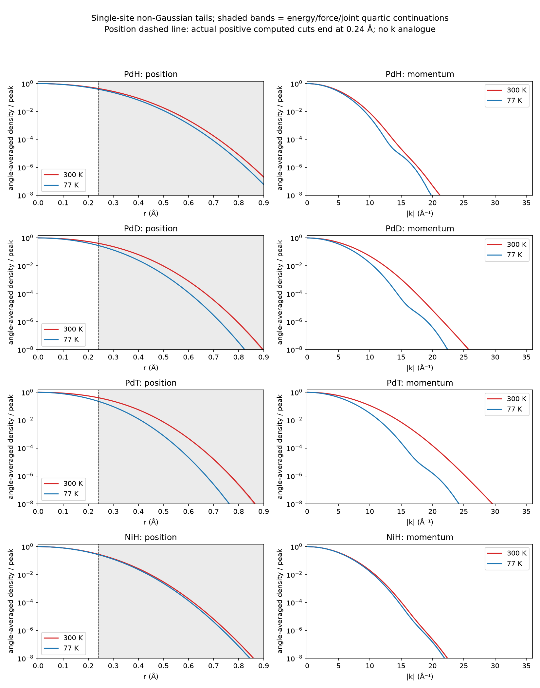
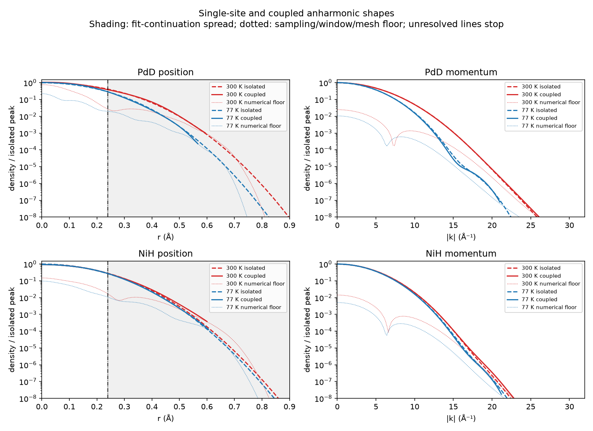

# Bulk quantum-site result

Update: the PdD well has been refitted with computed points out to 0.48 A and then to 0.8 A; see [bulk-refit-080](bulk-refit-080/README.md) and its [lead's note](bulk-refit-080/LEAD.md) (the 0.48 A step is in [bulk-refit-048](bulk-refit-048/README.md)). The numbers below change by under 2 percent. The energy of two neighbouring deuterons pushed together is in [pdd-nearest-pair](pdd-nearest-pair/LEAD.md).

At 300 K, the bulk PdD model puts about 57% of an isolated deuteron’s position probability outside 0.24 Å, the last displacement tested on the available well cuts. Coupling it to its neighbours changes the mean-square displacement from 0.081 to 0.083 Ų, smaller than the coupled sampling error at this temperature. A similar width does not establish a similar far tail. The shaded bands show how the fitted tails change when energy and force data are used differently; they are not error bars on the real material.

The momentum handoff gives the collision model a tested single-site input, distinct from the broader spectator bound it used before. The signed position table gives the entry model a spread in target location rather than one fixed point. Most coupled position tails remain unresolved at one millionth of their peak; no Gaussian tail is substituted.

Each position curve marks the 0.24 Å end of the positive computed full-loading cuts. Momentum bands compare the same potential continuations over the entire k range; there is no coordinate-cutoff-to-k boundary. These are finite fitted-well results, not exact DFT tails.

| Case | T (K) | Single ⟨r²⟩ (Ų) | Coupled ⟨r²⟩ ± block SE (Ų) | Single ⟨K⟩ (eV) | Coupled ⟨K⟩ (eV) | Probability inside 0.24 Å, single |
|---|---:|---:|---:|---:|---:|---:|
| PdD_300K | 300 | 0.080783 | 0.0834212 ± 0.0046 | 0.051816 | 0.0516146 | 0.43438 |
| PdD_77K | 77 | 0.0637381 | 0.0607365 ± 0.0012 | 0.03749 | 0.0366872 | 0.55196 |
| NiH_300K | 300 | 0.0652262 | 0.0691439 ± 0.0026 | 0.0791956 | 0.0789378 | 0.54456 |
| NiH_77K | 77 | 0.0627587 | 0.0619742 ± 0.00058 | 0.075588 | 0.0746103 | 0.56321 |
| PdH_Dhost_300K | 300 | 0.0919711 | 0.0932718 ± 0.0039 | 0.064809 | 0.0642674 | 0.38447 |
| PdT_Dhost_300K | 300 | 0.0770118 | 0.0790366 ± 0.0044 | 0.0474917 | 0.0473857 | 0.45234 |
| PdH_Dhost_77K | 77 | 0.0839019 | 0.0792699 ± 0.0012 | 0.0570102 | 0.0552962 | 0.4266 |
| PdT_Dhost_77K | 77 | 0.0543114 | 0.0520621 ± 0.0015 | 0.0296064 | 0.0290795 | 0.62861 |
| PdH_300K_hostH_reference | 300 | 0.0919711 | 0.0945287 ± 0.0035 | 0.064809 | 0.0642979 | 0.38447 |

### Isolated-reference peaks and contours (not coupled crossings)

| Isolated case | Position density / measure peak (Å) | Position 10⁻⁶ density / measure (Å) | Momentum density / measure peak (Å⁻¹) | Momentum 10⁻⁶ density / measure (Å⁻¹) |
|---|---:|---:|---:|---:|
| PdH_300K | 0 / 0.261 | 0.861 / 0.95 | 0 / 4.6 | 17.8 / 20.8 |
| PdH_77K | 0 / 0.244 | 0.833 / 0.922 | 0 / 4.4 | 17.2 / 19.6 |
| PdD_300K | 0 / 0.244 | 0.794 / 0.878 | 0 / 5.8 | 21.8 / 25.4 |
| PdD_77K | 0 / 0.211 | 0.728 / 0.806 | 0 / 5 | 19.2 / 22.2 |
| PdT_300K | 0 / 0.239 | 0.772 / 0.844 | 0 / 6.8 | 25.4 / 29 |
| PdT_77K | 0 / 0.194 | 0.672 / 0.75 | 0 / 5.4 | 20.6 / 24 |
| NiH_300K | 0 / 0.211 | 0.75 / 0.844 | 0 / 5 | 18.8 / 22 |
| NiH_77K | 0 / 0.211 | 0.739 / 0.828 | 0 / 5 | 18.4 / 21.6 |

## Axis shape and isotope meaning

Cubic symmetry fixes the full-model mean to zero and its exact second moments to ⟨x²⟩=⟨y²⟩=⟨z²⟩=⟨r²⟩/3; the sampled tensor/ratio below shows finite-chain uncertainty, not a measured breaking of cubic symmetry. The non-Gaussian angular shape still differs along [100]/[110]/[111]. D in PdD and H in NiH are directly sampled homogeneous host references. H/T labelled Dhost are mass tracers, from centroid-scaled paths with normalized importance weights in the D-isotope host; neighbours remain coupled. The sampled homogeneous H-host reference is a different case, not a tracer check.

| Case | Type | Sample ⟨x²⟩, ⟨y²⟩, ⟨z²⟩ (Ų) | Sample covariance λmax/λmin (cubic truth 1) | Sample mean along source axis (Å) |
|---|---|---:|---:|---:|
| PdD_300K | homogeneous isotope replacement | 0.027951, 0.029429, 0.02604 | 1.149 | 0.029389 |
| PdD_77K | homogeneous isotope replacement | 0.019385, 0.021139, 0.020212 | 1.093 | -0.0010256 |
| NiH_300K | homogeneous isotope replacement | 0.023173, 0.023525, 0.022446 | 1.13 | 0.0096668 |
| NiH_77K | homogeneous isotope replacement | 0.020218, 0.021311, 0.020446 | 1.067 | 0.00015962 |
| PdH_Dhost_300K | selected-site mass tracer in fixed D host; exact finite-P centroid-scaled importance weights | 0.031275, 0.031976, 0.030021 | 1.105 | 0.028974 |
| PdT_Dhost_300K | selected-site mass tracer in fixed D host; exact finite-P centroid-scaled importance weights | 0.02676, 0.028248, 0.024028 | 1.233 | 0.031109 |
| PdH_Dhost_77K | selected-site mass tracer in fixed D host; exact finite-P centroid-scaled importance weights | 0.026183, 0.027038, 0.02605 | 1.063 | -0.0085068 |
| PdT_Dhost_77K | selected-site mass tracer in fixed D host; exact finite-P centroid-scaled importance weights | 0.016532, 0.018628, 0.016902 | 1.138 | 0.0031629 |
| PdH_300K_hostH_reference | genuinely sampled homogeneous H host reference | 0.031957, 0.032137, 0.030434 | 1.138 | 0.019822 |

## Coupled tail resolution and reweighting

These are numerical detection limits only; bead, PES and overlap sensitivities remain separate. A missing 10⁻⁶ crossing is printed as unresolved, never extended with a Gaussian. Frame/block participation is not an autocorrelation-adjusted independent-sample count.

| Case | Weight ESS frames / blocks | ⟨K⟩ ± block SE (eV) | Position-density 10⁻⁶ crossing (Å) | Momentum-density 10⁻⁶ crossing (Å⁻¹) |
|---|---:|---:|---:|---:|
| PdD_300K | 792 / 12 | 0.051615 ± 0.00034 | unresolved | 22 |
| PdD_77K | 792 / 12 | 0.036687 ± 0.00011 | unresolved | 19.4 |
| NiH_300K | 792 / 12 | 0.078938 ± 0.00034 | unresolved | 19.2 |
| NiH_77K | 792 / 12 | 0.07461 ± 0.00011 | unresolved | 18.4 |
| PdH_Dhost_300K | 748.5 / 11.98 | 0.064267 ± 0.00053 | unresolved | 17.8 |
| PdT_Dhost_300K | 784.1 / 12 | 0.047386 ± 0.00025 | unresolved | 25.4 |
| PdH_Dhost_77K | 270.5 / 11.71 | 0.055296 ± 0.00026 | 0.7944 | 17.2 |
| PdT_Dhost_77K | 552 / 11.81 | 0.029079 ± 0.00015 | unresolved | 20.8 |
| PdH_300K_hostH_reference | 792 / 12 | 0.064298 ± 0.00043 | unresolved | 18 |

## Installed SSCHA: isolated-site anharmonic stiffness

The free-energy curvature below is not a discrete excitation level. The stationary Gaussian is supplied by analytic self-consistency, then the installed SSCHA force gradient and full Hessian are evaluated in the pinned order. Inversion symmetry makes the odd Hessian correction vanish for this isolated even well.

| Case | Bare local Kii (eV/Ų) | SSCHA Hessian trace/3 (eV/Ų) | Gradient residual / error norm (eV/Ų) | Force-rounding gradient change (eV/Ų) |
|---|---:|---:|---:|---:|
| PdD_300K | 0.590659 | 1.35066 | 0.001684 / 0.1515 | 4.08e-05 |
| PdD_77K | 0.590659 | 1.21066 | 0.001541 / 0.1236 | 3.25e-05 |
| NiH_300K | 1.71225 | 2.47339 | 0.001793 / 0.1851 | 3.6e-05 |
| NiH_77K | 1.71225 | 2.44759 | 0.00179 / 0.1788 | 3e-05 |
| PdH_Dhost_300K | 0.590659 | 1.46768 | 0.002051 / 0.1748 | 1.41e-05 |
| PdT_Dhost_300K | 0.590659 | 1.30928 | 0.001548 / 0.1433 | 3.23e-05 |
| PdH_Dhost_77K | 0.590659 | 1.40387 | 0.002024 / 0.1621 | 3.66e-05 |
| PdT_Dhost_77K | 0.590659 | 1.1197 | 0.001308 / 0.1054 | 3.02e-05 |

## Separate partial-loading and strain Gaussian contrasts

These are stationary Gaussian variational **model contrasts**, not sampled anharmonic tails and not new measured local stiffnesses. The measured source K/F0 and its original signed axis remain separate inputs. Quartics and unmeasured transverse/bond closures are transferred explicitly.

| Case | Actual occupied sites | Source original index | Signed source axis | Local K input: measured partial / Γ closure (eV/Ų) | F0 along axis (eV/Å) | Gaussian mean along axis (Å) | Gaussian ⟨r²⟩ (Ų) | Bare minimum eigenvalue (eV/Ų) |
|---|---:|---:|---|---:|---:|---:|---:|---:|
| Pd | 32 | 25 | (1,0,0) | 0.590659 | 0 | 0 | 0.0769173 | 0.201646 |
| x0875-spread4_clean | 28 | 25 | (1,0,0) | 0.70254 | 0.00249943 | -0.0100789 | 0.0766965 | -0.00774422 |
| x0875-spread4_near | 28 | 1 | (-0.7071,0,0.7071) | 0.529446 | 0.0704222 | 0.0564174 | 0.0826209 | 0.034692 |
| x0750-bunched8_clean | 24 | 25 | (1,0,0) | 0.73151 | 0.00220319 | -0.0158004 | 0.0759953 | 0.199897 |
| x0750-bunched8_near | 24 | 1 | (-0.7071,0,0.7071) | 0.47721 | 0.136166 | 0.112667 | 0.0955474 | 0.276425 |
| x0875-bunched4_near | 28 | 1 | (-0.7071,0,0.7071) | 0.430739 | 0.108599 | 0.0939161 | 0.08621 | 0.341416 |
| g3_shear100_g004 | 32 | 25 | (1,0,0) | 0.577963 | 0 | 0 | 0.0773452 | 0.139299 |
| g3_shear100_g008 | 32 | 25 | (1,0,0) | 0.547809 | 0 | 0 | 0.0786246 | 0.0554299 |
| g3_biax_m0p0200 | 32 | 25 | (1,0,0) | 0.804492 | 0 | 0 | 0.078421 | -0.268965 |
| g3_biax_0p0200 | 32 | 25 | (1,0,0) | 0.282665 | 0 | 0 | 0.0854117 | -0.106348 |

For the actual 300 K PdD single-site joint measure, excitation support is 0–0.7592 eV and kinetic-node support 0–2.595 eV: at 0.25 keV the unchanged g8 fixed-profile readout is 2.2934e-19, or 5.2107e-10 of its zero-removal spectator-envelope upper value over the declared 0–100 eV excitation support (current power 0).

## Meaning of the tables

`output/tables/*exact_position_band.csv`: angle-averaged spatial density ρ̄(r) (Å⁻³), its per-radius measure 4πr²ρ̄(r) (Å⁻¹), both peaks and 10⁻⁶ relative-to-own-peak cutoffs in `exact_summary.json`, and integrated exterior probability. The directional columns are on-axis densities, not plane marginals. The momentum analogue uses k=p/ℏ (Å⁻¹), density n̄(k) (ų), per-radius measure 4πk²n̄(k) (Å), and K=ℏ²k²/(2m) with the actual isotope mass. Isolated isotope references change the nucleus mass in the unchanged PdD-source Born–Oppenheimer potential and registered geometry; coupled host/tracer meanings are labelled separately. No isotope-specific DFT is asserted.

`*coupled_position_band.csv` is a conditional quartic bead marginal, not a Gaussian fit. Its spring/quadratic factor is integrated against the quartic and normalized at two Hermite orders; block uncertainty and unresolved rare bins remain visible. `*coupled_momentum_band.csv` is an unwindowed displaced-path transform with signed estimates (including negative noisy bins), block SE, mesh/window differences and free-end-action diagnostics. Importance-overlap diagnostics are separate: the reported support flag warns below 50 participating frames or four participating time blocks, not a physical enclosure. Continuation spread is not sampling error. No histogram zero or unresolved Fourier bin is called a resolved 10⁻⁶ tail. The finite basis comparison is recorded at the physical cutoff, not extrapolated into a Coulomb nuclear tail.

The coupled momentum table has **no joint excitation assignment**. Only `output/exact/PdD_*_joint_g8_joint.json` carries the true single-site canonical joint excitation/kinetic quadrature. It is isotropized conditional on each excitation for the existing g8 angular reader; removal is a separate explicit zero assumption. The actual fixed-profile reader case is `output/consumer_cases.json`; its declared excitation support is far below the existing 100 eV spectator support, and the recorded ratio locates this calculation within that envelope without changing density, profile or S factor.

For g9 use `*_g9_normal111_band.csv`: signed s=Δr·n_in in Å, n_in=+[111]/√3, positive into the declared metal half-space; P(s) has units Å⁻¹. [100]/[110] context and on-axis line density are separate columns/files. A plane marginal is not a trace on the incoming ray. `g9_mapping_example.csv` imports the actual table and applies z_target=Z0+s, Δt=s/v for a declared frozen ballistic example. The pinned g9 model has generic lab z only: this does not assign the separately commissioned slab orientation/offset to a bulk material surface.

## Inputs, partial loading, strain

`output/input_inventory.json` retains exact occupied original indices, axes, forces, folded graphs, source hashes, bare eigenvalues and closures. Adopted force Kii is local; scalar J is each source-shell mean multiplied by the actual occupied graph, once. Kii−ΣJ is diagnostic only, never subtracted from Kii again. Finite folded shell multiplicities are 12,3,12,3,1, not infinite FCC counts. Bare negative modes are not clamped; the bounded positive cubic quartic supplies stabilization.

Pd has measured ±0.03 Å [100] and +0.12/+0.24 Å [100]/[111]. No [110] scan: K4,110=(K4,100+3K4,111)/4 is a cubic prediction. NiH uses the updated source column/Kii and one +0.24 Å [100] quartic; [111] is explicitly the older g2 value. The displayed full-loading continuation band spans joint, energy-only and force-only quartic fits, not all possible continuations; missing larger signed cuts remain input uncertainty.

Partial models distinguish actual 0.875 spread clean/near, 0.75 bunched clean/near and 0.875 bunched near probes; there is no invented missing clean case or relaxation. The signed original probe vector and nonzero full F0 are retained. Only its measured parallel curvature is changed; transverse and unprobed K use full-loading closure, quartics are transferred from x1. Source-shell means are symmetrically transferred over the actual occupied set; a source shell with no occupied neighbour has no measured mean, and its other-site bonds explicitly use the x1 mean. Agreement at the measured source is not a measured global Hessian. Their 0.03 Å small-probe support is marked separately. The separate Gaussian contrasts do not supply anharmonic tail distributions.

Strain contrasts use only calibrated changes of the g3_skew collective Γ tensors: local K=bulk force-column Kii+[KΓ(strain)−KΓ(reference)] under frozen unstrained J, with transferred quartics. The k12 collective reference is not substituted for the k3 local Kii. No extrapolated EMT map enters. Missing strained local large displacements are an input uncertainty. Partial/strain rows are 300 K D Gaussian model contrasts, not additional chemical-profile production cases.

## Numerical reading

Angular comparisons are in `output/angular_sensitivity.json`: the higher-rule NiH77 isolated check and one actual coupled PdD300 seven/eleven-order comparison. At the latter numerical cutoff the angular change lies below the sampling/window/mesh floor; this is not an all-case angular error bound. Inside the 0.24 Å radial bracket is not the same as measured coverage at every direction.
The low temperature is 77 K: βℏω is larger, so the full cases use 128 primitive beads versus 32 at 300 K; PdD half-bead comparisons retain the same physical consumer. This controls the imaginary-time step at the local vibrational scale, not a guarantee for an unresolved high-k bin. Exact reference uses 10 parity states per axis versus 8, projected coordinate powers and Fourier-Hermite support; reported contours are finite-grid estimates (0.02 Å coordinate and 0.7 Å⁻¹ momentum interpolation pitch). Installed SSCHA provides local free-energy Hessian/gradient; analytic coupled Gaussian stationarity is separately labelled and never replaces the non-Gaussian distributions. Force-rounding sensitivity is a numerical provider check, not a DFT-force error bar. Hessian follows force evaluation and gradient, because the installed Hessian routine converts ensemble units.

### Three largest omissions

1. Electron–phonon damping.
2. Equilibrium distributions, not real-time dynamics.
3. No change of well during an ion’s arrival.

### Input/model uncertainties (separate)

Missing [110] and larger signed full-loading cuts, old-settings Ni [111], transferred partial/strained quartics, assumed transverse/bond closures, fixed-metal environment and registered unrelaxed partial sites; source mesh/finite-cell/fit uncertainties are not numerical solver error bars. Temperature changes the nuclear ensemble only: supplied geometry/loading remain fixed, not a thermal-expansion prediction. Nuclei are quantum distinguishable localized-site degrees of freedom; inter-well exchange/hopping is not included in this fixed-well Hamiltonian. Future surface/vacancy inputs are not part of this bulk deliverable.

Replay and the exact archive whitelist are in [replay.md](replay.md).

### Observed numerical sensitivity

At 77 K the PdD 64→128 bead kinetic change is -0.45 meV, versus combined block SE 0.213 meV; its far per-radius tail is unresolved at both bead counts.
The 77 K H tracer momentum/centroid-virial estimates differ by 2.15 meV, versus a conservative sum of block SEs 0.997 meV. This is live sampling/reweighting uncertainty, not claimed continuum agreement. The tabulated crossings describe numerical detection only.
