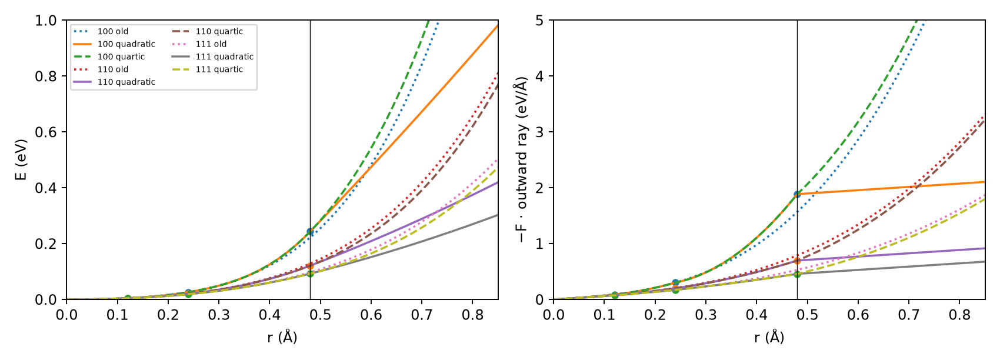
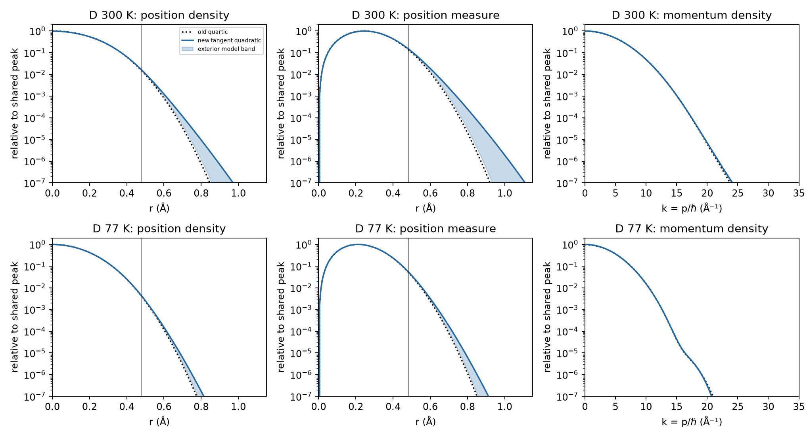
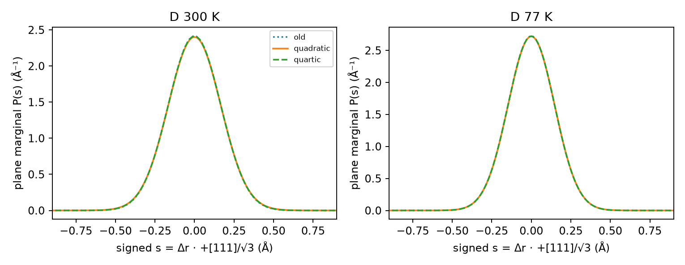

# PdD: what the signed 0.48 Å cuts change

At **300 K**, the isolated D mean-square displacement changes from **0.080576 to 0.082840 Ų** with the softer exterior, or **0.081341 Ų** with old-quartic curvature outside the last cut. The primary change is +2.81%.
At **77 K**, the isolated D mean-square displacement changes from **0.063528 to 0.064070 Ų** with the softer exterior, or **0.063801 Ų** with old-quartic curvature outside the last cut. The primary change is +0.85%.

These are predictions of a frozen-neighbour, single-site Born–Oppenheimer well, not measured nuclear tails. The actual cuts constrain three rays, **not a whole 0.48 Å ball**. Continuation spread remains a model uncertainty even where the quantum calculation converges. No fit to yield, profile or S factor is made.

## Anchors, regularity and exterior choices

For each ray, a piecewise cubic Hermite curve in **r** matches both electronic energy E and outward slope −F at 0.12, 0.24 and 0.48 Å. This is genuinely nonquartic; no energy/force compromise is hidden in a PCHIP fit. Independently native ±[110] rows are averaged after converting the fixed-axis force to its outward sign. Native +[100]/+[111] at 0.48 have inversion-derived negative rows, **not second independent calculations**. Old +0.12/+0.24 [100]/[111] and the signed near-K input are retained.

The largest signed-native averaging residual is 2.9e-06 eV in E and 5.78e-05 eV/Å in projected F. This parity discrepancy is not a DFT-error bound. Every ray's original/averaged anchors, old-model residuals and signed residuals are in `results/potential_evidence.json` and `tables/energy_force_anchors.csv`.

Below 0.03 Å the exact old cubic quartic polynomial is retained, with common harmonic K=0.590658683 eV/Ų. Thus the angular closure is polynomial at the origin, rather than attaching an O(r⁴) coefficient to a singular sextic angular invariant. At larger r set xᵢ=uᵢ²/r², q=x₁x₂+x₂x₃+x₃x₁ and p=x₁x₂x₃, and use V=w₁₀₀V₁₀₀+w₁₁₀V₁₁₀+w₁₁₁V₁₁₁ with w=(1−4q+9p, 4q−36p, 27p). These nonnegative weights sum to one (Schur/AM–GM), match all three cuts, and give a C¹ cubic-symmetric closure. Monotone positive radial segments and positive confining extensions exclude negative angular wells in this declared closure; they do not establish unmeasured angular physics.

The two new models are identical through 0.48 Å. For t=r−0.48>0, **quadratic** (primary) is E_R+s_Rt+Kt²/2; **quartic** (alternative) is E_R+s_Rt+(K+3a_ray R²)t²/2+a_ray R t³+a_ray t⁴/4 using the positive old ray quartics. Both match E and slope, and confine positively. Their structural spread is not a tiny coefficient-fit error bar.

Computed force is the analytic −∇V, including angular derivatives. Nonspecial-direction finite differences, including every splice, give max absolute force/gradient discrepancy 1.74e-07 eV/Å at 10⁻⁶ Å step; two-sided C¹ splice diagnostics are recorded separately.

## Matched 3D quantum result

The same 3D Cartesian Hermite Galerkin solver treats old and new wells, with all parity sectors, actual isotope masses and canonical weights. The distributions are **genuine eigenstate mixtures and Fourier transforms**, not Gaussian fits or classical momenta. Geometry, source F0=0 and old neighbour graph are unchanged. Positive-octant 3D arrays plus exact reflection symmetry and the saved spectra define the full distributions.

| D temperature | Well | ⟨r²⟩ (Ų) | ⟨Kinetic⟩ (eV) | P(r>.24 Å) | P(r>.48 Å) | line anisotropy at .48 |
|---|---|---:|---:|---:|---:|---:|
| 300 K | old | 0.080576 | 0.051545 | 0.56472 | 0.02686 | 4.331 |
| 300 K | quadratic | 0.082840 | 0.051266 | 0.57182 | 0.03291 | 5.623 |
| 300 K | quartic | 0.081341 | 0.051567 | 0.56806 | 0.02854 | 5.465 |
| 77 K | old | 0.063528 | 0.037219 | 0.44671 | 0.00927 | 2.984 |
| 77 K | quadratic | 0.064070 | 0.036952 | 0.44977 | 0.01019 | 3.559 |
| 77 K | quartic | 0.063801 | 0.037121 | 0.44863 | 0.00957 | 3.548 |

Anisotropy is max/min of the [100]/[110]/[111] spatial line densities at the stated radius, not a covariance symmetry breaking. Cubic symmetry fixes ⟨x²⟩=⟨y²⟩=⟨z²⟩ and zero signed mean. Full directional curves are retained, including momentum anisotropy.

**Density is not radial measure:** spatial ρ̄(r) has units Å⁻³, whereas 4πr²ρ̄(r)=dP/dr has units Å⁻¹. Momentum uses k=p/ℏ (Å⁻¹), n̄(k) (ų) and 4πk²n̄(k) (Å). Tables retain both, their peaks and tails. The plot scales each observable by a shared old/new peak; the band is exterior-model spread, not numerical error. There is no .48 Å→k cutoff.

The signed [111] table integrates a plane transverse to +[111]/√3: P(s) ds, s=Δr·n, is a location probability (Å⁻¹). It is not the density sampled on the ray. No physical slab offset/orientation or arrival dynamics is inferred from the bulk reference.

### Numerical sensitivity, separately from continuation

| D temperature | Well | Δ⟨r²⟩ (Ų) | Δ⟨Kinetic⟩ (eV) | ΔP(r>.48) | position / momentum density 10⁻⁶ |
|---|---|---:|---:|---:|---|
| 300 K | old | +1.77e-09 | +3.08e-09 | +3.98e-09 | 0.795 Å / 21.8 Å⁻¹ |
| 77 K | old | -2.77e-10 | +6.86e-10 | +1.54e-07 | 0.725 Å / 19.2 Å⁻¹ |
| 300 K | quadratic | -1.35e-06 | +4.28e-07 | -4.38e-06 | 0.89 Å / 22 Å⁻¹ |
| 77 K | quadratic | -8.2e-07 | +5.65e-07 | -1.17e-06 | 0.755 Å / 19.2 Å⁻¹ |
| 300 K | quartic | -5.06e-07 | +1.77e-07 | -6.57e-07 | 0.805 Å / 21.8 Å⁻¹ |
| 77 K | quartic | -4.17e-07 | +2.86e-07 | +1.23e-07 | 0.73 Å / 19 Å⁻¹ |
The matched old 300 K solution differs from the archived known positive baseline by -0.000207 Ų in ⟨r²⟩ and -0.000271 eV in kinetic energy because the archive used linearly interpolated radial integration. Reapplying that archived reporting convention to this same old solution reproduces it within 6e-13 Ų and 8e-13 eV; the old/new table instead uses direct matrix moments.
The matched old 77 K solution differs from the archived known positive baseline by -0.000210 Ų in ⟨r²⟩ and -0.000271 eV in kinetic energy because the archive used linearly interpolated radial integration. Reapplying that archived reporting convention to this same old solution reproduces it within 8e-17 Ų and 3e-17 eV; the old/new table instead uses direct matrix moments.

Δ compares 10→12 parity states per Cartesian axis (20→24 HO levels), potential quadrature 48→64, position-grid pitch .020→.016 Å, momentum pitch .60→.48 Å⁻¹ and angular GL24×48→GL32×64. It is an empirical combined numerical difference, **not** the continuation band or a rigorous enclosure. See `results/numerical_evidence.json` for integrated distribution differences and all density/measure crossing decisions. A 10⁻⁶ crossing is printed only if its local difference is below 2×10⁻⁷ of the peak and its location is stable within two output steps; all other crossings remain unresolved. Resolved numerical contours outside .48 Å are still extrapolated physical predictions.

### Mass and temperature sensitivity in the same PdD electronic surface

| Isotope | T | Old ⟨r²⟩ | New ⟨r²⟩ range (Ų) | Old kinetic | New kinetic range (eV) |
|---|---|---:|---:|---:|---:|
| H | 300 K | 0.091763 | 0.092293–0.095199 | 0.064266 | 0.063250–0.064323 |
| H | 77 K | 0.083693 | 0.083969–0.085398 | 0.056470 | 0.055423–0.056431 |
| T | 300 K | 0.076806 | 0.077685–0.078795 | 0.047311 | 0.047169–0.047322 |
| T | 77 K | 0.054101 | 0.054360–0.054444 | 0.029426 | 0.029278–0.029326 |

These are isolated mass substitutions, not H/T-specific electronic calculations or new coupled ensembles. They use the main solver resolution; the explicit higher-resolution comparison is for D. Temperature changes the canonical ensemble only, not the cell or thermal expansion.

## Actual joint-host tagged sensitivity

Coupled048 consumed the same local E(x), all 801 retained frames at 32/128 beads (300/77 K), the actual co-beaded neighbour field, D mass and old occupied graph. The exact finite-P ratio is exp[−β mean_beads(V_new−V_old)] for **one selected site**, not a 32-site refit. Nine contiguous-block ratio errors include paired old/new covariance. Retained frame ESS is 796–800 and block ESS ≈9; participation is not proof of unseen overlap or fully independent blocks.

| T | Old MSD | Quadratic MSD | Quartic MSD | Quadratic paired change ± SE (Ų) | old→quadratic P(r>.48) |
|---|---:|---:|---:|---:|---:|
| 300 K | 0.083363 | 0.085131 | 0.083715 | +0.001768 ± 0.000441 | 2.938%→3.398% |
| 77 K | 0.060785 | 0.061173 | 0.060971 | +0.000387 ± 0.000108 | 0.787%→0.841% |

The warmer ensemble remains broader under both continuations, and the tagged change is small against the warm–cold separation. The saved **true signed [111] displaced-path characteristic** changes at separation .25 Å by +.00267 ± .00080 (300 K) / +.00253 ± .00028 (77 K) for the primary model. At that witness about 27%/33% of its numerator involves shifted paths with a bead beyond .48 Å. This is therefore a continuation-sensitive momentum diagnostic, **not** a validated momentum tail or all-cell replacement. The direct shifted-target numerator and original-polynomial callback controls agree at ~10⁻¹⁵. No Fourier inversion, Gaussian replacement, new i-PI run, or fabricated excitation is supplied.

## Handoff and boundary

`tables/report_table.csv` and `results/report_table.json` are the standalone decisive statistics. Position/momentum bands and signed-111 marginals are direct table handoffs. `coupled_position.csv` retains annular measures, sampling SE and paired differences; `coupled_characteristic_111.csv` retains the actual characteristic and overlap. `well.py` is the shared local potential API. [Replay, exact inputs and units](replay.md), `ARCHIVE_FILES.txt`, `SHA256SUMS` and `capsule.json` bind one unpublished scoped capsule. Governing plan: `coherencev1-g10-pdd-refit048-20261124` (sole writer WideWellDelivery).

**What remains unmeasured:** off-ray angular structure, every exterior continuation, electronic-structure/systematic errors, connected pair/contact response, surfaces/vacancies, damping and well changes during arrival. No 0.80 Å data or NiH additions are implied. This updates equilibrium one-body inputs only; no collision/yield improvement is claimed and no direct g8 excitation comparison is asserted.
