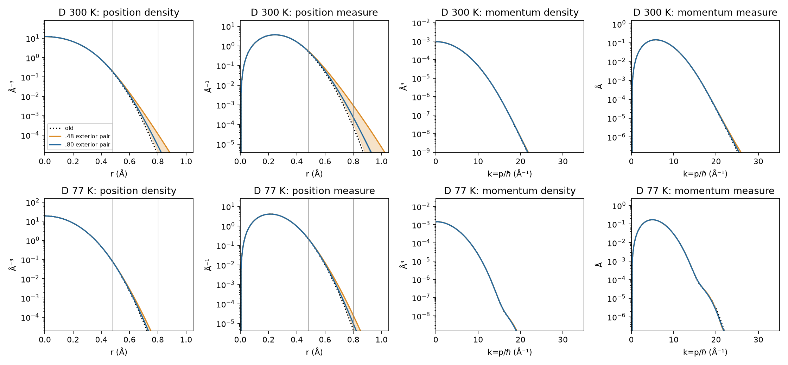
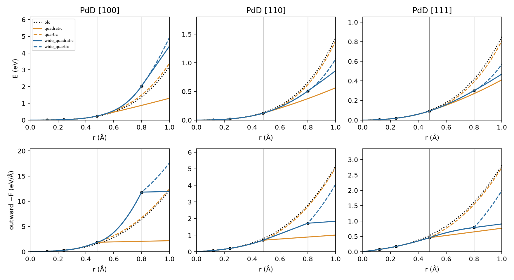
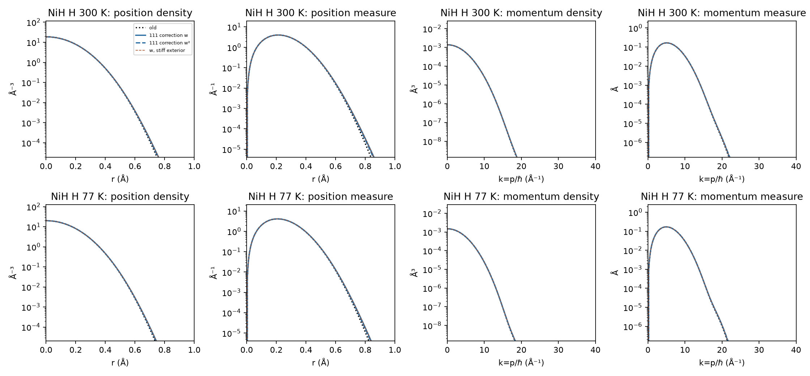

# G10 bulk: what the complete 0.80 Å cuts change

**Unpublished, equilibrium one-body update for Axiom.** The PdD 0.80 Å data remove a material *radial-continuation* ambiguity in the ordinary D distribution, without establishing the unmeasured angular surface. They do not demonstrate a collision, contact or yield improvement.

## PdD: more constrained, not dramatically broader

Same D mass, near K=0.590658683 eV/Ų, F0=0, original atom 25, cubic angular closure and old neighbour graph. Old/.48 results are the accepted archived results, not rerun fits. The .80 models retain exactly the accepted interpolant through .48 Å, then match new E and −F at .80 Å. Both exteriors match that value/slope; one has bare-K quadratic curvature, the other old positive ray-quartic curvature and higher Taylor terms.

| Isolated D | old | .48 exterior pair | .80 exterior pair |
|---|---:|---:|---:|
| 300 K MSD (Ų) | .08057605 | .08134120–.08284006 | .08159865–.08159923 |
| 77 K MSD (Ų) | .06352839 | .06380062–.06406990 | .06384083–.06384084 |
| 300 K kinetic (eV) | .05154482 | .05126571–.05156651 | .05153429–.05153439 |
| 77 K kinetic (eV) | .03721907 | .03695241–.03712136 | .03710051–.03710052 |
| 300 K P(r>.48 Å) | .02685778 | .02853956–.03290937 | .02930461–.02930586 |
| 77 K P(r>.48 Å) | .00926861 | .00957426–.01019134 | .00966762–.00966763 |

The .80 update gives **+1.27% / +0.49% MSD versus old at 300 / 77 K**. Its remaining exterior-pair MSD spread (5.8×10⁻⁷ / 1.1×10⁻⁸ Ų) is no larger than the empirical basis/quadrature/grid change (~7.1×10⁻⁷ / 5.1×10⁻⁷ Ų): do not interpret those last digits as physically resolved. The .48 spread was .001499 / .000269 Ų. This is evidence that the chosen .80 exterior choices no longer control the ordinary moments, **not** a bound on all admissible continuations or angular models.

Rare tails are a separate scale: .80 models predict P(r>.80 Å)=**7.04–7.35×10⁻⁶** (300 K), **2.38–2.42×10⁻⁷** (77 K). The .48 pair gave 2.87–39.6×10⁻⁶ and 1.38–7.26×10⁻⁷. New tail differences exceed the main/check tail-integration differences, but remain conditional on the angular closure and extrapolated exterior. They are finite numerical comparisons, not rigorous enclosures or measured nuclear probabilities.

These are full 3D canonical eigenstate mixtures and their Fourier transforms, **not Gaussian fits**. Spatial density ρ̄(r) (Å⁻³) is distinct from radial measure 4πr²ρ̄(r)=dP/dr (Å⁻¹); momentum uses k=p/ℏ (Å⁻¹), density n̄(k) (ų), measure 4πk²n̄(k) (Å). No r cutoff is converted into a momentum cutoff. Curves are in absolute units; shaded intervals are the two exterior models, not numerical confidence bands. At .48 Å the new spatial line-density max/min is 5.575 / 3.577 (300 / 77 K), while cubic symmetry still fixes equal coordinate variances. Signed [111] tables are transverse-plane marginals of location, not ray densities or arrival-direction probabilities.

Plots stop near 10⁻⁶ of the old peak to avoid presenting unresolved far-tail structure as physics; the plot window is not a physical cutoff.

## Which old extrapolation fails?

At .80 Å, the native PdD [100] wall is **E=2.034612 eV, outward −F=11.829698 eV/Å**. The old quartic predicts 1.378392 / 6.419432. Even the .48 continuation pair (E=.877646–1.501833; −F=2.075669–6.738042) misses it: that old band was a heuristic sensitivity, **not a bracketing uncertainty interval**. At [110]/[111], the native values (.506971/1.718986 and .300593/.788641) lie between the .48 pair, and are softer than the original quartic. The [100] compression is a many-ion frozen-neighbour electronic cut, **not a validated two-body repulsive interaction**.

Hermite segments match E and outward −F exactly; their derivative minima are positive on every segment. Below .03 Å the old polynomial is unchanged. The same nonnegative cubic angular weights sum to one and match [100]/[110]/[111], so the declared closure has no negative radial well. Three rays do not measure an angular volume or an entire .80 Å ball. Native signed [110] ±.12/.24/.48 are averaged with correct outward force signs; derived negative branches at .80 (and [100]/[111] .48) are **not extra independent calculations**. Original signed rows, full atom-order forces and provider semantics are retained in the exact input set.

## Joint host: one changed site, not an all-cell refit

Reweighting uses the **same local callback**, D mass, full old occupied graph, actual co-beaded field and all 801 saved frames at P=32/128. The exact finite-P one-site weight is exp[−β mean_beads(Vnew−Vold)]. Nine contiguous block ratio errors preserve paired covariance; sampled weight ESS≈799/801 and block ESS≈9 do not guarantee unseen overlap or remove remaining time correlation.

| T | old MSD | .80 MSD (Ų) | paired change ± block SE (Ų) | old→.80 P(r>.48) |
|---|---:|---:|---:|---:|
| 300 K | .08336325 | .08389190 | +.00052865 ± .00024612 | .029377→.030467 |
| 77 K | .06078537 | .06100039 | +.00021502 ± .00006209 | .007871→.008075 |

No saved source bead reaches .80 Å: identical sampled .80 position results for the two exteriors mean **no information on their rare-tail difference**, not proof of zero tail. Such common-table probabilities are null, with raw zero counts labelled separately. No coupled kinetic energy is inferred.

The true signed [111] displaced-path characteristic at conjugate separation .25 Å changes by **+.000232±.000340** (300 K), **+.001574±.000225** (77 K). These differ from the .48 soft-extension changes +.002671 / +.002530 and show why the updated same-callback consumer matters. They are bounded finite-P momentum diagnostics, not a reconstructed momentum tail. Direct shifted-target controls agree at floating-point roundoff. The warm–cold width ordering is unchanged.

## NiH: the new [111] cut still leaves angular uncertainty

NiH has **three new native positive [111] points** (.24/.48/.80 Å), with derived negative partners, not new [100]/[110] data. At .80 the native E/−F=.500529 eV/.988128 eV/Å are softer than old .663463/1.947519. Two full 3D cubic closures add that same fitted [111] correction with weight w=27z₁z₂z₃ or w² (zᵢ=xᵢ²/r²); they agree on the measured [111] cut, retain old [100]/[110], near K/F0, H mass and host graph, but differ between rays.

| Isolated NiH H | old | new angular pair w/w² |
|---|---:|---:|
| 77 K MSD (Ų) | .06254842 | .06281557–.06299292 |
| 300 K MSD (Ų) | .06501622 | .06536262–.06558804 |
| 77 K kinetic (eV) | .07504639 | .07456668–.07476441 |
| 300 K kinetic (eV) | .07865361 | .07823535–.07840890 |
| 77 K P(r>.80 Å) | 2.66×10⁻⁷ | 4.21–4.92×10⁻⁷ |
| 300 K P(r>.80 Å) | 4.69×10⁻⁷ | 7.99–9.51×10⁻⁷ |

The new-cut MSD increase is **0.43–0.71% at 77 K, 0.53–0.88% at 300 K**; P(r>.48) rises 3.6–5.8% / 4.2–6.7%. The [111]-only data do **not** choose between those angular closures. Their MSD spread .000177/.000225 Ų is far larger than the ~10⁻⁷ Ų numerical comparison, and their >.80 probability spread 0.70/1.52×10⁻⁷ exceeds the change from an eightfold exterior-curvature stress (0.072/0.183×10⁻⁷). The actionable remaining uncertainty is angular completion, not more digits or a larger routine radial replay.

The NiH tagged finite-P MSD change for w is **+.000467±.000056 Ų (77 K), +.001049±.000200 Ų (300 K)**; w² is smaller. H mass, graph and actual neighbour fields remain fixed; ESS≥798/801 and block ESS≈9. The table's tagged NiH kinetic entries use a differentiated **centroid-virial estimator**, not a sampled momentum PDF; tagged >.80 probabilities remain null (zero visits). Its isolated momentum densities are genuine Fourier eigenstate mixtures. All refit deltas use matched old operator moments: the legacy coarse integral-grid MSD is ~.000210 Ų higher, not the correct baseline for subtracting the new rows. The owner’s [exact equations, paired errors and replay](nih/README.md), `nih/support.json` and `nih/observable_table.json` remain the source evidence.

## Portable handoff and boundary

`results/observables.json` and `tables/observables.csv` are the common standalone statistics (material, isotope, temperature, variant, MSD, kinetic energy, P(r>.48), P(r>.80)); model/numeric support is separate and unsupported entries are null. Full PdD directional/density/measure curves, signed-plane marginals, exact force residuals and paired tagged changes are in `tables/` and `results/`. See [replay and input contract](replay.md), `prerequisites.json`, `ARCHIVE_FILES.txt`, `SHA256SUMS` and `capsule.json` for the exact unpublished local delivery.

**Not supported:** new angular data, electronic-structure error bounds, connected pair/contact response, surface/vacancy response, phonons, dynamics during arrival, damping, thermal expansion, all-cell replacement, or a yield/S-factor fit. H/T substitutions are not rerun: the established material consumer is D in PdD and H in NiH.
