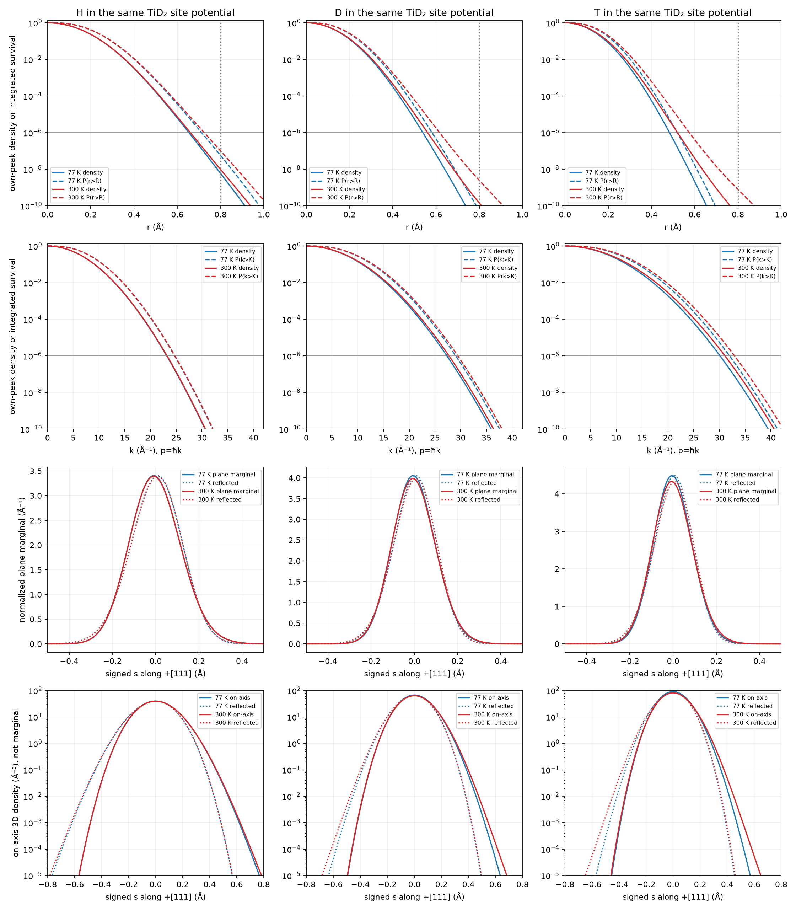
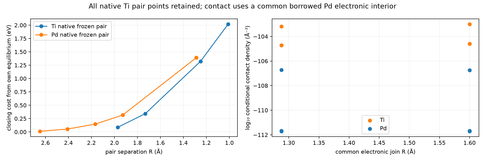

# TiD₂: a stiff, tetrahedral single-site well and a conditional pair comparison

This capsule uses the supplied **constrained cubic, fully occupied fluorite** electronic calculation. It does not establish the phase, loading or surface of a titanium foil. H/D/T change only the nuclear mass in the same frozen-neighbour potential; the source static calculation used D. Energies below are eV (or explicitly meV), position Å, wave number Å⁻¹, and momentum p=ħk. The electronic energy is the force-consistent free energy per simulated cell; one-site energy rises are for one displaced nucleus.

## What the source actually says

Atom 8 is at the +tetrahedral site in conventional cubic x=[100], y=[010], z=[001] coordinates. +[111] moves away from one nearest Ti and toward the other three; −[111] moves toward that one Ti. At r=0.80 Å their electronic rises are respectively **0.584880 and 5.294128 eV**. This ninefold lopsidedness is retained, not averaged away. [100] softens as displacement grows; [110] is intermediate. These are computed frozen-ion rays, not measured three-dimensional spectra.

| r (Å) | [100] symmetry mean (eV) | [110] symmetry mean (eV) | +[111] (eV) | −[111] (eV) |
|---|---:|---:|---:|---:|
| 0.12 | 0.040003 | 0.040512 | 0.034365 | 0.047009 |
| 0.24 | 0.156971 | 0.165021 | 0.116855 | 0.219326 |
| 0.48 | 0.581936 | 0.702899 | 0.333750 | 1.202917 |
| 0.80 | 1.361042 | 2.131038 | 0.584880 | 5.294128 |

The true [100]/[110] twofold signed residuals are small: max energy differences 3.44e-06/2.08e-06 eV and rotated-force differences 0.00199/0.000372 eV/Å. Only those symmetry-equivalent rays are averaged. All 24 selected point bytes, displacement signs, energy rises and projected forces were checked against their native records. The mesh comparison is **4→6 at zero and −0.48 Å [111] only**, changing that rise by 0.002392 eV; it is not a whole-surface or pair error estimate.

The regular T_d interpolant and matched synthetic exterior were declared before implementation in [model.md](model.md). It reproduces ray energies and slopes, includes the allowed odd xyz tetrahedral term, and is polynomial at the origin. Few rays do **not** identify a full angular surface. These are localized-well distributions conditional on that closure, not periodic diffusion among tetrahedral/interstitial sites. The oscillator basis is on all space, not a hard box.

## Finite-model levels and the two [100] transitions

The three-dimensional Hamiltonian is −ħ²∇²/(2m)+V. “Exact diagonalization” means the declared finite projected model, not an exact measured 3D potential. Twenty oscillator functions per Cartesian coordinate and order-40 Gauss-Hermite potential quadrature are used; the eight coordinate-parity sectors couple in tetrahedral pairs through xyz, rather than incorrectly imposing inversion symmetry. Full canonical multiplets are included.

| isotope | 3D ground energy (meV) | first 3D gap (meV) | next 3D excitation clusters (meV; multiplicity) |
|---|---:|---:|---|
| H | 228.453 | 146.709 (triplet) | 272.960 (1), 289.015 (3), 300.036 (2) |
| D | 161.607 | 105.004 (triplet) | 199.788 (1), 208.185 (3), 213.273 (2) |
| T | 132.062 | 86.232 (triplet) | 165.624 (1), 171.339 (3), 174.634 (2) |

Observed low-cluster multiplicities are 1,3,1,3,2; no inversion-parity labels are assigned. Both temperatures use these same levels with different canonical weights. Higher low levels and adjacent cluster gaps are in `output/single_site.json`.

| isotope | 1D [100] E₁−E₀ (meV) | E₂−E₁ (meV) | χ=(E₂−E₁)−(E₁−E₀) (meV/quantum) |
|---|---:|---:|---:|
| H | 149.491 | 146.651 | -2.841 |
| D | 106.330 | 104.918 | -1.412 |
| T | 87.101 | 86.161 | -0.940 |

This is exactly the G13 convention: successive eigenlevel spacings of the **one-dimensional neighbour ray**, not the 3D triplet gap or a thermal stiffness. The PdD values 42.647/47.989 meV belong to its **[110]** ray; they are provenance, not Ti values. The 0.002→0.001 Å spacing comparison changes Ti gaps by at most 0.004 meV and leaves all isotope softening signs unchanged.

For a carrier k and sideband p, define d=[ε(k+p)+ε(k−p)]/2−ε(k). Before damping, instability requires **d(d+2χn)<0**. Ti’s negative χ is compatible with positive d (positive local curvature at small p), with 0<d<2|χ|n in that model. The source-derived single-site sign does not locate a band, determine its bandwidth/coupling, give a growth rate, or establish a damped threshold. No envelope simulation was run.

## Full distributions before widths



Each `*_position.csv` gives angle-averaged density ρ̄(r) [Å⁻³], radial probability measure 4πr²ρ̄ [Å⁻¹], and integrated survival P(|x|>r). Each `*_momentum.csv` analogously gives n̄(k) [ų], 4πk²n̄ [Å], and survival; it also gives physical SI p=ħk, density with the (ħ·10¹⁰)⁻³ Jacobian and radial measure with the (ħ·10¹⁰)⁻¹ Jacobian. Both position and momentum are derived from the same normalized canonical eigenstates, using Fourier phases (−i)^n, not mass-relabeling a position curve.

**Own-peak semantics:** density and radial-measure cutoffs are independently the first outward post-peak crossing of 10⁻⁶ of that same curve’s own peak. These are different radii and different from “probability 10⁻⁶.” Integrated survival at each crossing is retained, not set equal to 10⁻⁶. The table below uses the density crossings. Synthetic support begins at r>0.8 Å in position only; there is no corresponding k-space measurement boundary.

| isotope | K | per-axis MSD (Ų) | r at density 10⁻⁶ (Å) | P(r>r₆) | k at density 10⁻⁶ (Å⁻¹) | P(k>k₆) | P(r>0.8 Å) |
|---|---:|---:|---:|---:|---:|---:|---:|
| H | 77 | 0.013873 | 0.6537 | 6.68e-06 | 23.148 | 5.3e-06 | 5.65e-08 |
| H | 300 | 0.013986 | 0.6604 | 7.08e-06 | 23.207 | 5.28e-06 | 1.01e-07 |
| D | 77 | 0.009756 | 0.5392 | 5.92e-06 | 27.320 | 5.03e-06 | 5.34e-11 |
| D | 300 | 0.010144 | 0.5611 | 7.07e-06 | 27.717 | 4.96e-06 | 2.47e-09 |
| T | 77 | 0.007953 | 0.4835 | 5.61e-06 | 30.119 | 4.91e-06 | 2.69e-13 |
| T | 300 | 0.008606 | 0.5201 | 7.48e-06 | 31.071 | 4.8e-06 | 7.89e-10 |

T_d makes all three canonical Cartesian MSDs equal (reported separately with their observed anisotropy ratio). It does not make the two [111] sides equivalent: `*_g9_plus111.csv` and `*_g9_minus111.csv` preserve the distinct signed on-axis cuts **and** actual normalized plane-integrated marginals. A line density ρ(s n) has units Å⁻³ and is not a 1D probability density. The marginal ∫ρ(s n+t a+u b)dtdu has units Å⁻¹. Their skew shapes can differ while the vector mean remains zero. Real stationary eigenstates have even momentum occupation under k→−k even though position is not inversion symmetric.

### What the numerical and closure comparisons change

Basis 16→20 changes the first six excitation clusters by at most 6.815e-06 meV. `output/numerical_controls.json` gives per-isotope/temperature MSD, kinetic, crossing and exterior-tail changes, and the absolute curve difference at each curve’s own 10⁻⁶ crossing. These are empirical numerical differences, not rigorous enclosures. The selected finite-model tolerances are 0.1 meV for low clusters, 1% for MSD/mean kinetic and 0.02 Å / 0.5 Å⁻¹ for density crossings; sub-threshold curve differences are shown directly, including any unresolved crossing.
- H 300 K quadrature48: ΔMSD=-4.63e-10 Ų, Δr₆=-4.28e-08 Å, Δk₆=-6.65e-07 Å⁻¹, ΔP(r>0.8)=-2.25e-12.
- H 300 K fine_density_grid_and_angles: ΔMSD=-7.98e-17 Ų, Δr₆=5.36e-06 Å, Δk₆=0.000172 Å⁻¹, ΔP(r>0.8)=1.58e-11.
- H 300 K unmeasured_angular_and_exterior: ΔMSD=-0.000541 Ų, Δr₆=-0.0347 Å, Δk₆=0.802 Å⁻¹, ΔP(r>0.8)=-8.09e-08.
The largest basis-difference/own-peak-threshold ratio at these crossings is 3.75e-05; no unmeasured angular or electronic error is included in that ratio. The H 300 K density-grid/angular comparison separately prices interpolation/cubature. The ray-preserving angular penalty plus stiffer exterior is a **model sensitivity**, not a confidence interval: it changes unmeasured support while preserving all ray anchors and slopes. Where that change exceeds finite-model numerical differences, interpretation follows the closure sensitivity rather than extra solver digits.
This comparison changes the H 300 K MSD by −3.9%, moves the spatial density crossing inward by 0.035 Å and the momentum crossing outward by 0.802 Å⁻¹, and reduces the already small synthetic-exterior probability from 1.01×10⁻⁷ to 2.03×10⁻⁸. The localization conclusion survives, but unique 3D tail digits are not identified by the rays. The main reported numbers remain the declared base closure, not an average of closures.

## G8/G9 handoff actually exercised

`output/*_g8_joint.json` contains the real G8 state dictionaries: `excitation_eV`, `kinetic_eV`, `probabilities`. Joint probabilities include the canonical level weight and normalized Fourier kinetic quadrature conditional on that eigenstate; excitation and kinetic energy are not assumed independent. Each isotope uses its own mass. Kinetic bins retain probability and conditional mean; angular correlations are deliberately isotropized for this consumer.

The retained TiD2 conditional excitation nodes are far below the existing G8 spectator envelope excitation cap of 100 eV; the envelope is distribution-free in momentum, so this site table supplies a shape inside that assumption, not a new envelope or Ti foil yield.

The actual `BoundSpectatorKernel.fold` read the D 300 K table with the already existing **TiD** profile as a numerical-interface exercise and returned a finite positive value; it was not relabeled as a TiD₂ rate or compared with foil charts. H/T state measures are supplied, but their unequal-mass collision physics was not invented inside this D-D reader. `output/consumer_evidence.json` records six normalizations, conditional kinetic checks and bound source hashes. Existing PdD tables are untouched.

G9 has no crystallographic density-CSV API. Its applicable signed ballistic convention was exercised with the actual module constants: s=x·n, z_target=Z₀+s, Δt=s/v, n=+[111]/√3. The opposite normal reflects s and the density; `output/g9_mapping.csv` carries both mappings. This is a registered bulk crystal direction, **not an assigned Ti foil surface**.

## Frozen nearest pair, beside PdD



The integrated pair files are consumed directly from [pair/README.md](pair/README.md) and `pair/result.json`; unchanged PdD evidence was reused, not rerun. Pair closing uses u per site and R=R₀−2u. The connected JSON force is −dW/du, distinct from the all-atom mixed-force response. All four measured pair rows, including the two shortest with unknown PAW-overlap behavior, remain in the main result. No dedicated pair mesh control exists. The contact comparison is the existing pure l=0 radial general-pair model with a common Coulomb core and **borrowed PdD electronic inner shape**, not a Ti nuclear rate or measured Ti inner potential.

| separation R (Å) | native Ti closing cost (eV) | native connected mutual W (eV) |
|---|---:|---:|
| 1.971552 | 0.085783 | 0.005776 |
| 1.731552 | 0.342238 | 0.028295 |
| 1.251552 | 1.321096 | 0.157224 |
| 1.011552 | 2.016738 | 0.296972 |

| common join R (Å) | preparation | Ti log₁₀ρ(0) [Å⁻³] | Pd log₁₀ρ(0) [Å⁻³] | log₁₀(Ti/Pd) |
|---|---|---:|---:|---:|
| 1.287824 | thermal_77K | -104.72844 | -111.67417 | 6.94572 |
| 1.287824 | thermal_300K | -103.18760 | -106.72042 | 3.53282 |
| 1.287824 | cold_ground | -104.72845 | -111.71416 | 6.98571 |
| 1.600000 | thermal_77K | -104.58819 | -111.67447 | 7.08627 |
| 1.600000 | thermal_300K | -103.01195 | -106.75256 | 3.74061 |
| 1.600000 | cold_ground | -104.58820 | -111.71408 | 7.12588 |

Only the frozen longitudinal nearest-pair line is supplied. It is **not** a full coupling matrix, phonon band, relaxation response or lattice bath, and no PdD J is transferred to Ti.

## Three dominant omissions

1. The full angular and exterior energy surface and the actual foil phase/surface are unknown. The few signed rays support a conditional localized model, not an identified diffusion landscape.
2. Neighbours and electrons do not respond dynamically: no coupled-lattice thermal state, electron-phonon damping, real-time response or change in the well during an ion’s arrival. Only the frozen nearest-pair closing path is present.
3. Pair contact lacks a Ti electronic inner cut and uses a common borrowed PdD interior; the pair has no independent mesh control and the shortest two points have no PAW-overlap check. Contact values express this conditional outer-wall sensitivity, not a material yield.

## Files and rerun

- `inputs/`: selected native source bytes, signed ray table and mesh comparison; `output/source_evidence.json` binds their identities and signs.
- `well.py`, `model.md`: declared regular interpolation and synthetic continuation.
- `solve.py`, `output/single_site.json`, `output/*csv`, `output/*g8_joint.json`: isotope spectra, distributions and native reader states; saved eigenvectors allow density reuse.
- `output/numerical_controls.json`, `output/*resolution.csv`, `output/*closure.csv`: deciding basis, quadrature, observable-grid and model-sensitivity comparisons.
- `pair/`: actual G11 consumer, native-register evidence, reused PdD reference and conditional contact comparison.
- `manifest.json`, `SHA256SUMS`: only this directory, accepted base `463910dcf13ce69d74b138a21d53183129a779de`; no lead pages, private paths or neighboring campaigns.

The masses are 1.00782503223, 2.01410177812 and 3.01604928199 u (the existing G10 neutral-atom isotope-mass approximation to nuclear masses; electron mass is neglected). `output/integration_evidence.json` directly checks survival integrals, beyond-crossing support and the physical momentum Jacobian, and compares G8 conditional kinetic means with the Fourier-grid means.

From the accepted repository root, with Python 3.12+, NumPy, SciPy and Matplotlib installed:

```sh
export OPENBLAS_NUM_THREADS=3 OMP_NUM_THREADS=3 MKL_NUM_THREADS=3
python3 g10_quantum_site/tid2-site/solve.py produce
python3 g10_quantum_site/tid2-site/solve.py controls
python3 g10_quantum_site/tid2-site/consume.py
OPENBLAS_NUM_THREADS=1 OMP_NUM_THREADS=1 python3 g10_quantum_site/tid2-site/pair/run.py
python3 g10_quantum_site/tid2-site/report.py
python3 g10_quantum_site/tid2-site/package.py
sha256sum -c g10_quantum_site/tid2-site/SHA256SUMS
```

The source electronic calculations, PdD bulk evidence and envelope runs are not replayed by these commands. The authenticated draft release is unpublished; its download-byte receipt is external to the frozen scientific archive. No push, publication or merge is part of this delivery.
