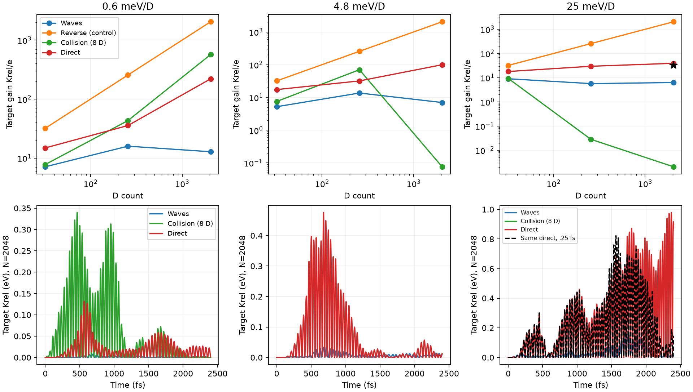

# Can a distributed bulk PdD launch focus onto one D–D pair?

**Finite-model result, unpublished.** The target is the actual D25→D63 [110] bond; every launch uses the same total N e. Wave/direct launches start with zero target velocity and zero displacement. Reverse recovery and localized collisions are shown, but are not silently promoted to collective preparation.

## Actual nonlinear launch feedback

The new launches use **the same initial N e, zero displacements, zero target velocities and original per-site speed cap**. They are adjusted against the actual nonlinear motion, not another harmonic proposal bank. All scoring remains on the **2400-fs, strictly pre-first-exit** trajectory. The original data and quantum/rate readouts below are unchanged; **none of these new peaks is mapped to a nuclear rate or physical emission**.

At N=2048, dt=.25 fs, the best observed total peaks move **.47757698→.56911272 eV** at 4.8 meV/D and **.82574185→1.02732391 eV** at 25 meV/D. The latter is **receding**: its simultaneous inward energy is zero. The 25-meV launch nevertheless has a different inward pulse of **.96908597 eV**, and reaches **R=1.45894679 Å** at another time. These are not one common state.

At **N=16384/.6 meV/D, the original dt=.5 fs**, nonlinear feedback gives **.29466114 eV**, inward, versus the original **.12483784-eV receding** maximum. The inward baseline is **.11604428 eV**. The selected launch reaches **R=1.92415029 Å**, versus **2.22284101 Å** originally, and stays inside the original extent through 2400 fs. Its searches stopped while still improving: **no plateau or asymptotic ceiling is established**.

### Simultaneous target states, conservative dynamics

`c` is signed inward speed; **negative means receding**. “Min R” is selected separately, not inferred from energy. Each row gives the quantities at the **same sample**.

| N; meV/D | Objective | Krel (eV) | Strictly inward K (eV) | c (Å/fs) | Time (fs) | Actual R (Å) |
|---|---|---:|---:|---:|---:|---:|
| 2048; 4.8 | Max total K | .56911272 | .56911272 | +.10444273 | 678 | 2.83577493 |
| 2048; 4.8 | Max inward K | .56911272 | .56911272 | +.10444273 | 678 | 2.83577493 |
| 2048; 4.8 | Min R | .00001077 | 0 | −.00045437 | 2217.25 | 1.70358222 |
| 2048; 25 | Max total K | 1.02732391 | 0 | −.14032427 | 1380.25 | 2.92819174 |
| 2048; 25 | Max inward K | .96908597 | .96908597 | +.13628882 | 1351.5 | 2.78767232 |
| 2048; 25 | Min R | .00007027 | 0 | −.00116052 | 1365.5 | 1.45894679 |
| 16384; .6 | Max total K | .29466114 | .29466114 | +.07515200 | 1551.5 | 2.83610421 |
| 16384; .6 | Max inward K | .29466114 | .29466114 | +.07515200 | 1551.5 | 2.83610421 |
| 16384; .6 | Min R | .00002186 | .00002186 | +.00064732 | 1569 | 1.92415029 |

The objective-matched original inward baselines are **.47757698/.80892035 eV**, not the wrong-signed total peak at 25 meV. Original closest target separations were **1.78565397/1.55206134 Å**. At 4.8 meV the final closest approach belongs to a late pulse, not the energy maximum at 678 fs.

| N; meV/D; selected objective | Half-objective hold (fs) | Largest site radius in scored prefix (Å) | Smallest NN R in scored prefix (Å) | First original exit (fs) |
|---|---:|---:|---:|---:|
| 2048; 4.8; total / inward K | 18.5 | .72426968 | 1.70578315 | none |
| 2048; 4.8; min R | 20.5 | .76631554 | 1.70358222 | none |
| 2048; 25; total K | 17.75 | .79720556 | 1.45894679 | 1578.25 |
| 2048; 25; inward K | 18 | .79720556 | 1.45894679 | 1578.25 |
| 2048; 25; min R | 18.25 | .79720556 | 1.45894679 | 1578.25 |
| 16384; .6; total / inward K | 22 | .51831795 | 1.92415029 | none |
| 16384; .6; min R | 23 | .51831795 | 1.92415029 | none |

All these holds are completed sampled intervals. A min-R half-approach hold is **not** an energy-pulse duration. The 25-meV exit is **after every scored target state**; no selected state uses an artificial exterior before its score. The near-edge excursion does not establish a material ceiling or validate the missing outer force surface.

### One 4100-fs amplitude loss, inside the dynamics

The same initial energy, cap, dt and horizon are retained. Post-hoc damping of the conservative trace is a separate kinetic-only comparison, **not** a lossy trajectory or its geometry.

| N; meV/D | Original seed under loss: K (eV) | Post-hoc conservative K (eV) | Selected conservative launch under actual loss: K (eV) | Reoptimized under loss: K (eV) |
|---|---:|---:|---:|---:|
| 2048; 4.8 | .41198849 | .40884937 | .48022764 | .48249979 |
| 2048; 25 | .33108957 | .52402469 | .56077189 | .77735349 |
| 16384; .6 | .08153605 | .13826370 | .21670233 | .26806682 |

| N; meV/D; lossy K maximum | Inward K (eV) | c (Å/fs) | Time (fs) | R (Å) | Half-K hold (fs) | Max scored radius (Å); first exit (fs) |
|---|---:|---:|---:|---:|---:|---|
| 2048; 4.8 | .48249979 | +.09616735 | 683.75 | 2.85565968 | 19 | .64829510; none |
| 2048; 25 | 0 | −.12206421 | 1052.25 | 2.88584379 | 18.5 | .79785178; 1259.75 |
| 16384; .6 | 0 | −.07168043 | 1695 | 2.86436454 | 22 | .51605484; none |

The high-energy and pumped-16k lossy maxima are **receding**. The high-energy support exit occurs later, not before the quoted peak. On the pumped lossy launch, the separate maximum inward energy is **.23853523 eV at 1734.5 fs, R=2.99092882 Å**; its separate closest approach is **1.99519349 Å at 1677 fs**, with only **.00004629 eV** inward energy. They do not co-occur with its total-energy maximum. No other loss value, thermal model, electronic input or rate change enters this comparison.

### What actually stopped

Independent objective searches retain their accepted histories and feasible rejected steps. Final selection reranks **all observed feasible trials**, including a rejected inward-search step that supplies the best 4.8-meV min R. The 25-meV and pumped-16k distance-search launches supply their best observed total and inward energy as well as min R; the independent energy searches found smaller local winners. The delivered inward result is never replaced by an inferior independently optimized branch.

The declared local gain-plateau resolution is **0.2%**, challenged by a larger feasible step. It is not an assertion of exact stationarity.

The 4.8-meV total/inward and both N2048 lossy energy searches have measured local gain-plateau/backtracking stops. The 25-meV min-R branch has a measured feasible fixed-time backtracking stall. **No objective-matched plateau is claimed** for the 4.8-meV cross-selected min R, the 25-meV cross-selected K/inward winners, or any pumped-16k objective, including loss. The latter branches were still improving at their declared search stops. Those are best observed states, not global optima. A local plateau is not a convergence proof for timestep, horizon, preparation class or the real material.

Exact independent histories are in `nonlinear_N*.json/.npz`; the delivered cross-objective selections are in `nonlinear_selection.json/.npz`. Simultaneous vectors, first-exit geometry, the settled changed-consumer proof and the new unpublished delta capsule are described in [method.md](method.md). Overlay the delta on the accepted baseline for its unchanged original figure and tables.

The settled consumer proof passes: the saved selections satisfy the fixed launch constraints, dominate every observed feasible trial for their objective, and reproduce the actual native readout. Conservative/4100-fs-loss directional derivative defects are **.061%/.026%**; native and adjoint endpoint x/v are bitwise equal in that witness, and wrong-sign/omitted-loss controls are rejected. All **35 prior manifest entries outside the two edited pages** are byte-unchanged. This is finite-model implementation evidence, not electronic or timestep validation.

## Retained eleven-candidate and original comparisons

The retained **.25-fs direct re-selection** at N=2048/25 meV/D gives **.82574185 eV**, receding, after all 11 allowed trials. This is the selected fine-step bank peak, **not a converged peak or an incident incoming state**. The original .5-fs optimum was .98026130 eV and inward. At pumped .6 meV/D, the supported 131k direct peak is **.35082778 eV**, inward; its energy fraction is only .4461%.

## Pumped-size continuation: .6 meV/D

The original target-zero preparations, N-scaled energy, .5-fs step, 2400-fs horizon and all-step support stop are unchanged. Each new size evaluates **3 wave + 11 direct candidates**. Waves retain at most **16 reciprocal modes**, not a 16-mode lattice dispersion approximation. The 32/256/2048 anchors below are reused without rerunning them; raw added candidates and traces are in `continuation_results.json` and `continuation_traces.npz`.

| N | Wave Krel (eV); gain; budget fraction | Direct Krel (eV); gain; budget fraction |
|---:|---:|---:|
| 2048 (retained) | .00767756; 12.7959; .6248% | .13236639; 220.611; 10.7720% |
| 16384 | .00691055; 11.5176; .07030% | .12483784; 208.063; 1.26992% |
| 131072 | .00623939; 10.3990; .007934% | .35082778; 584.713; .446101% |

At 16k, wave/direct peaks occur at **1623.5/1799 fs**, with **28/22-fs** holds and signed inward speeds **+.011086/−.048916 Å/fs**. Both selected traces complete the horizon without support exit. Wave/direct maximum site radii are **.12965/.34750 Å**, minimum actual NN separations **2.67221/2.22284 Å**, and positive-site launch participations **8237.4/6889.6 D**. Both target preloads and initial potential energies are zero. The direct winner is `direct_mixture_-0.25`; its negative sign is receding, not an incident beam energy.

At 131k, wave/direct peaks occur at **678/1781.5 fs**, with **27.5/21-fs** holds and inward speeds **+.010603/+.082002 Å/fs**. Maximum site radii are **.14960/.54806 Å**, minimum actual NN R **2.68105/1.90329 Å**, and positive-site launch participations **67456.6/47490.0 D**. Both target preloads and initial potential energies are zero; both complete 2400 fs without support exit. Direct again selects `direct_mixture_-0.25`.

Adjacent direct finite peak exponents are **.4204, .8771, −.02816, .49690**; wave exponents are **.3871, −.1045, −.05062, −.04913**. The ~6% direct decrease at 16k **does not persist** at 131k: gain recovers while the energy fraction still falls. Neither saturation nor an asymptotic power law follows. No selected large-size trace is clipped by support, and the selected pulses are not at the horizon; the bounded launch class and finite 2400-fs search remain limitations. These waves are only the unchanged capped family, not all wave fields.

The actual proposal times are 1700/1980/2140 fs at 16k and 1940/2100/2260 fs at 131k. A phase proposal is not the nonlinear arrival time (the largest-box wave chooses a 678-fs pulse). On the accepted 64³ harmonic-symbol grid, the sampled fastest speed gives ~92.86 Å in 2400 fs, versus a 130.688-Å box side and ~113.2-Å minimum-image corner distance. This sampled harmonic distance is **not a nonlinear causal bound** and does not establish whole-register arrival or horizon convergence. No additional horizon/size sweep is inferred. The largest pumped register has only **78.6432 eV total**, below 100 eV even at perfect concentration.

## Fine re-selection: 2048 D, 25 meV/D

At **.25 fs**, all **3 adjoint + 4 phase + 4 mixture** direct candidates were reranked at that timestep. The winner is `direct_mixture_-0.50`: **Krel=Krad=.8257418508 eV**, **1563 fs**, **18.75-fs** completed half-peak hold, signed inward speed **−.12580597 Å/fs** (receding), gain **33.0297**, and **1.61278%** of the 51.2-eV budget. It completes **2400 fs with no support exit**; maximum site radius **.785776 Å**, minimum actual NN separation **1.552061 Å**, relative energy drift **6.5273×10⁻⁵**.

The next best is `direct_mixture_+0.25`, **.76309662 eV** at **2250.5 fs**, also without exit. The winner happens to be the original coarse winner's launch, but this result now comes from the complete **fine-step search**, not only its previous fixed-launch replay. The three base proposals are 800/1240/1500 fs; the third and two phase trials do exit support, with their supported-prefix scoring retained. The original .98026130-eV/2367.5-fs inward peak and this receding peak are not one common incoming state. Small energy drift is not late-time peak convergence; no forced timestep ladder or saturation claim is made.

## Lifted support: two artificial exterior models

**Outside-computed-range sensitivity, not new electronic data.** The N=2048 direct search is repeated at .25 fs for 4.8/25 meV/D with the .8-Å/1.287824-Å stop **lifted**. All original crossings remain logged at every step, but selection uses each complete extended trace. Soft/stiff local rays match the accepted E and force at .8 Å; the stiff exterior is the accepted quadratic-plus-old-ray-quartic Taylor continuation. Pair exteriors match W(.8)=.37638437 eV and W′(.8)=1.71678790 eV/Å, with positive curvatures **.1/6.45392836 eV/Ų**, preserving the same projected q and forces. Neither refits the on-domain functions nor extrapolates the last cubic.

| meV/D | Exterior | Selected Krel (eV) | Peak / hold (fs) | Signed inward speed (Å/fs) | First original exit | Peak / ±10-fs neighbourhood outside extent? |
|---:|---|---:|---:|---:|---|---|
| 4.8 | soft | .4775769803 | 679.25 / 19.25 | +.09567551 | none | no / no |
| 4.8 | stiff | .4775769803 | 679.25 / 19.25 | +.09567551 | none | no / no |
| 25 | soft | .8257418508 | 1563 / 18.75 | −.12580597 | none | no / no |
| 25 | stiff | .8257418508 | 1563 / 18.75 | −.12580597 | none | no / no |

All four winners complete 2400 fs with no declared model failure. The 4.8-meV winner is `mixture_−.25`, with max radius **.586849 Å**, minimum actual NN R **1.785654 Å** and drift **5.1970×10⁻⁵**; at 25 meV the winner is `mixture_−.50`, max radius **.785776 Å**, minimum NN R **1.552061 Å** and drift **6.5273×10⁻⁵**. The selected paths never invoke the exterior, so their equality is not evidence that the two unknown outer force laws are physically equivalent.

| meV/D; model | Raw trials crossing original extent | Earliest crossing (fs) | Largest site radius over the search (Å) | Minimum actual NN R over the search (Å) |
|---|---:|---:|---:|---:|
| 4.8; soft / stiff | 0 / 11 each | none | .61385855 / .61385855 | 1.78565397 / 1.78565397 |
| 25; soft | 3 / 11 | 1033 | **.84393858** | 1.55206134 |
| 25; stiff | 3 / 11 | 1033 | **.83916361** | 1.55206134 |

At 25 meV, phase trials 2/3 first cross at **1033 fs**; the 1500-fs base proposal first crosses at **1760 fs**. They continue to the full horizon without near-collision, lineage or numerical-failure stop, but none overtakes the selected target peak. The two models do differ on those outer excursions. **.8 Å is therefore not a demonstrated dynamical ceiling**, and lifting it does not produce a larger selected target peak in this bounded search.

The settled changed-consumer check passes: shared on-domain energies/forces and propagated x/v are **bitwise equal**, with zero difference in the first ten trajectory diagnostics. The actual soft/stiff `direct_1500fs` traces are bitwise equal before their first exit and different afterward. At the observed outer maxima, force/energy-gradient defects are **6.20×10⁻⁹ / 5.38×10⁻⁹ eV/Å**, with full-trace energy drift **6.815×10⁻⁵** and no model-failure stop. Synthetic C1 and noncollinear outer-force checks are retained separately from observed states. These are implementation/numerical sanity checks, not electronic validation or timestep convergence.

### Actual geometry to request next, without starting a force job

The largest excursion is **not the target**: row **1927**, original D15 translated by **(24.504,24.504,0) Å**, at **2155.5 fs** in the soft `direct_1500fs` trace. Its simultaneous displacement is **(−.596754691,−.596754689,1.11×10⁻⁹) Å**, radius **.843938576 Å**, unit crystal direction **(−.707106782,−.707106780,1.32×10⁻⁹)**. The stiff counterpart reaches .839163607 Å at 2155 fs, displacement (−.593378277,−.593378277,1.30×10⁻⁹) Å.

At the soft maximum, the actual closest pair is **1428→1927**, original D41→D15 in their stated tiles, **R=2.02329115 Å**, **q=.13183466 Å**. Its displacements are **(.014562429,.014562400,2.83×10⁻¹¹)** and the D15 vector above; inward projections are **.02059436/.84393858 Å**. This is not the symmetric q=.84394 cut and is not the target pair. The smallest R anywhere in the search instead occurs on **target rows 12→31 (D25→D63)** at **1547.75 fs**, with displacements approximately **±(.472263451,.472263451,0) Å**, **R=1.55206134 Å**, **q=.66788138 Å**.

An explicitly **off-axis** outer point is the soft phase-2 state at **1099.5 fs**, row **163** (original D7, tile (0,8.168,8.168) Å): **x=(.537845564,.573396744,−.193415160) Å**, **r=.809611698 Å**, unit direction **(.664325337,.708236733,−.238898673)**. Its closest NN is row **168**, displaced **(.059130124,.038448918,.117602745) Å** simultaneously, with **R=2.193580864 Å but projected q=0**. Phase 3 supplies the opposite-z state. These are retained as actual noncollinear vectors, not replaced by a symmetric approach inferred from separation.

Request native energies **and full Cartesian forces** at the recorded outer one-site vectors, the simultaneous unequal two-site vectors above, and the off-axis phase-crossing states retained in the JSON/NPZ. Use their actual vectors, not R→symmetric-q or invented collinear replacements. A connected two-site check needs the matching zero and separate one-site subtractions under the same electronic settings. The full simultaneous D displacement/velocity arrays, atom/tile identities and actual closest-pair vectors are retained in `continuation_states.npz`/`continuation_results.json`; a proposed electronic embedding must state which surrounding displacements it keeps. This nominates discriminating inputs, **not an authorized DFT job** or angular validation.

## Same-budget comparison

At **dt=.5 fs**, each cell is **gain K_rel/e; contiguous half-peak hold (fs)**. † is initially preconcentrated/not headline-eligible; ‡ marks an edge-censored hold. The final direct anchor has the visible .25-fs sensitivity below. Absolute energies, target radial component, separation, crossings and same-trajectory whole-cell maximum are in [comparison.csv](comparison.csv).

| D count | meV/D | Waves | Reverse | Collision | Direct |
|---:|---:|---:|---:|---:|---:|
| 32 | 0.6 | 7.11; 29.5 | 32; 14.0†‡ | 7.77; 30.5 | 14.9; 27.5 |
| 32 | 4.8 | 5.2; 27.5 | 32; 12.0†‡ | 7.53; 28.5 | 17.3; 24.0 |
| 32 | 25 | 9.01; 22.5 | 32; 10.0†‡ | 9.32; 22.5 | 18; 20.0 |
| 256 | 0.6 | 15.9; 27.5 | 256; 12.0†‡ | 43.2; 26.5† | 35.6; 25.5 |
| 256 | 4.8 | 13.6; 25.5 | 256; 9.0†‡ | 70.1; 21.0† | 31.9; 22.5 |
| 256 | 25 | 5.68; 22.5 | 256; 4.5†‡ | 0.0282; 1.5†‡ | 29.6; 18.5 |
| 2048 | 0.6 | 12.8; 28.0 | 2.05e+03; 9.0†‡ | 569; 20.5† | 221; 24.0 |
| 2048 | 4.8 | 6.98; 24.5 | 2.05e+03; 3.5†‡ | 0.0759; 1.0†‡ | 99.5; 19.0 |
| 2048 | 25 | 6.29; 22.5 | 2.05e+03; 1.5†‡ | 0.00206; 0.0†‡ | 39.2; 18.5 |

Direct launch positive-site-energy participation is 827/2048, target preload 0%. Collision participation is 8: its eight-site packet gets more energetic as N grows, not more extensive. Reverse states have positive-site participation 2–9.44 and target site-energy fraction 8.7–1e+02%; exact recovery is a reachability control wherever that launch is poorly spread.

## What limits the result?

3/36 selected trajectories hit the .80-Å site or 1.287824-Å nearest-bond boundary; every quoted peak is strictly before any exit, and censored holds remain labelled. The same supported-prefix rule is used for every family. The model's extent is a box of assumed support, not measured angular coverage.

At N=2048/.6 meV the same-launch harmonic peak is 0.472 eV before its site-boundary exit at 703 fs, versus 0.132 eV for the nonlinear trajectory. At 25 meV the harmonic trajectory exits at 150 fs, long before the nonlinear peak: its 0.0235-eV supported prefix is **clipping, not a same-horizon nonlinear advantage**. The one fixed 4136-fs amplitude-loss sensitivity changes the coarse high-energy direct peak to 0.316 eV (-67.7%). No damping sweep was used.

The same launch at .25 fs peaks at **0.826 eV** at 1563 fs, versus 0.98 eV at 2367.5 fs at .5 fs: -15.8%, so **the largest-energy peak is not numerically converged**. Holds are 18.5/18.75 fs; energy drift is 0.00027/6.5e-05. Both exact same-launch rows and their pre-peak exits are retained. The updated local wall costs 1–3.46 times the old harmonic wall at the actual most-displaced site's sampled directions above .03 Å (maximum radius 0.7858 Å). The .25-fs trajectory reaches the finite horizon without a support exit; neither a near-end peak nor a first boundary crossing establishes saturation. The matched high-energy harmonic trajectory exits early, so its smaller supported peak is clipping, not a same-horizon nonlinear advantage.

| Same launch, no reoptimization | .5 fs | .25 fs |
|---|---:|---:|
| Peak Krel = radial K (eV) | 0.9802612980 | 0.8257418508 |
| Peak time / half-peak hold (fs) | 2367.5 / 18.5 | 1563 / 18.75 |
| Signed inward speed (Å/fs) | +0.13707240 (inward) | -0.12580597 (receding) |
| First support exit | none by 2400 fs | none by 2400 fs |

This is late-pulse/peak-selection sensitivity, **not changed clipping**: the fine trace near the coarse peak (±30 fs) reaches only 0.188 eV. The two opposite signs must not be treated as the same incoming state.

## Energy floors first; extrapolations second

Perfect-concentration floors for 100 eV / 1 keV are N ≥ **166,667 / 1,666,667** at .6 meV/D, **20,834 / 208,334** at 4.8 meV/D and **4,000 / 40,000** at 25 meV/D. At N=2048 the per-D floors are **48.83 / 488.28 meV**, before inefficiency. Neither target is simulated.

**Scaling is finite and preparation-dependent, not an asymptotic limit.** Direct gain slopes are between 32→256 and 256→2048 D at .5 fs. The 25-meV anchor is not converged; the table exposes both timestep-based arithmetic assumptions rather than claiming a fitted high-energy size law.

| anchor meV/D | two coarse finite-size exponents | 100 eV / 1 keV N if efficiency stays fixed | eV/D at N=2048 if gain stays fixed |
|---:|---:|---:|---:|
| 0.6 | 0.42, 0.877 | 1.55e+06 / 1.55e+07 | 0.453 / 4.53 |
| 4.8 | 0.293, 0.547 | 4.29e+05 / 4.29e+06 | 1.01 / 10.1 |
| 25 | 0.24, 0.135 | 2.09e+05 / 2.09e+06 (.5 fs); 2.48e+05 / 2.48e+06 (.25 fs) | 2.55 / 25.5 (.5 fs); 3.03 / 30.3 (.25 fs) |

Those N and e values are **assumption-only extrapolations**, not simulated reachable states; measured efficiency is already energy-dependent, and the largest-energy step sensitivity limits its numerical anchor. `results.json` also retains the finite-size power-law scenarios and their incompatible slopes/residuals. No three-point flattening or growth establishes saturation or its absence. The fixed 2400-fs horizon, nonlinear wall/defocusing and model exits remain distinct.

## Conditional quantum contact and G12

**Retained unchanged:** the table below belongs to the original .5-fs selection and its same-launch .25-fs refinement, not the new fine-step reselection or artificial exterior peaks. No added peak is mapped to contact or rate.

All 36 target peaks have a [retained per-level lookup](results.json), with both joins and both original flagged-row treatments. The illustrative assignment is **ΔE=classical K_rel above each quantum model’s own ground**, not equality to an eigenenergy or an inferred quantum state. Adjacent l=0 eigenlevels are separately reported; their endpoint span is not a rigorous wavepacket bound.

| Base-10 logs, stationary-level assignment only | .5-fs peak: lower / upper endpoints | .25-fs peak: lower / upper endpoints |
|---|---:|---:|
| contact (Å⁻³) | [-92.86,-88.73] / [-91.81,-87.70] | [-94.86,-91.81] / [-93.87,-90.78] |
| emitted p/s | [-85.09,-80.97] / [-84.04,-79.94] | [-87.10,-84.04] / [-86.10,-83.01] |
| emitted p/true C | [-80.67,-76.55] / [-79.62,-75.52] | [-82.68,-79.62] / [-81.68,-78.59] |
| PdD .25-keV k0 | [-86.31,-82.19] / [-85.26,-81.16] | [-88.31,-85.26] / [-87.32,-84.23] |
| PdD .25-keV k1 | [-85.51,-81.39] / [-84.46,-80.36] | [-87.52,-84.46] / [-86.53,-83.43] |

These are **one continuously active normalized-pair** units, not detector counts, a foil rate or a peak×hold event yield. Preparation probabilities, radial populations and coherence are unknown. The retained excitation support ends at 7.906–7.969 eV; no 100-eV/1-keV contact or rate is extrapolated.

**Three largest omissions:** (1) the off-ray local/connected angular force surface is not measured; (2) dynamic Pd/electrons, finite-temperature disorder and physical damping are absent except the stated one sensitivity; (3) generating the prescribed phases and converting a classical focus into occupied quantum radial states is not supplied.

The closest connected alternate-H difference is −0.0047422856 eV, with signed slope difference +0.0413149205 eV/Å; this finite-cutoff comparison is not a PAW error bound.

Equations, selection, support and portable commands: [method.md](method.md). The added unpublished root-relative capsule is `continuation.tar.gz`, with exact source/data/input hashes in `continuation_manifest.json` (self excluded; archive identity is reported separately). Prior-input assumptions remain in `input_manifest.json`; no contact or .80-well calculation was rerun.
