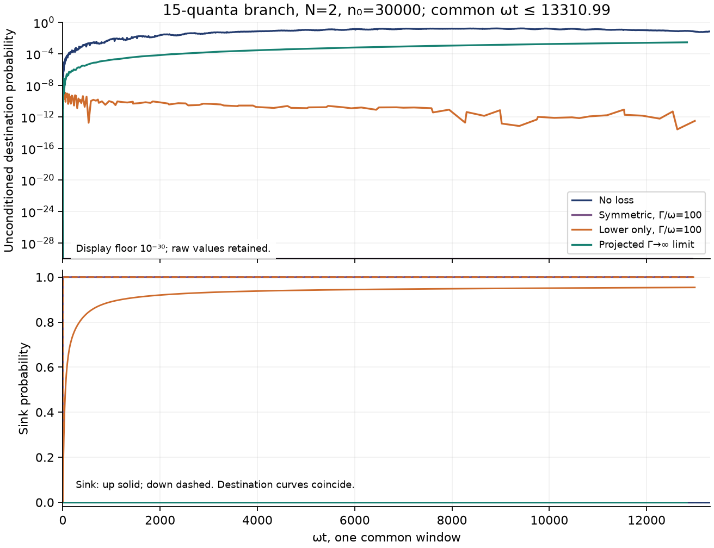
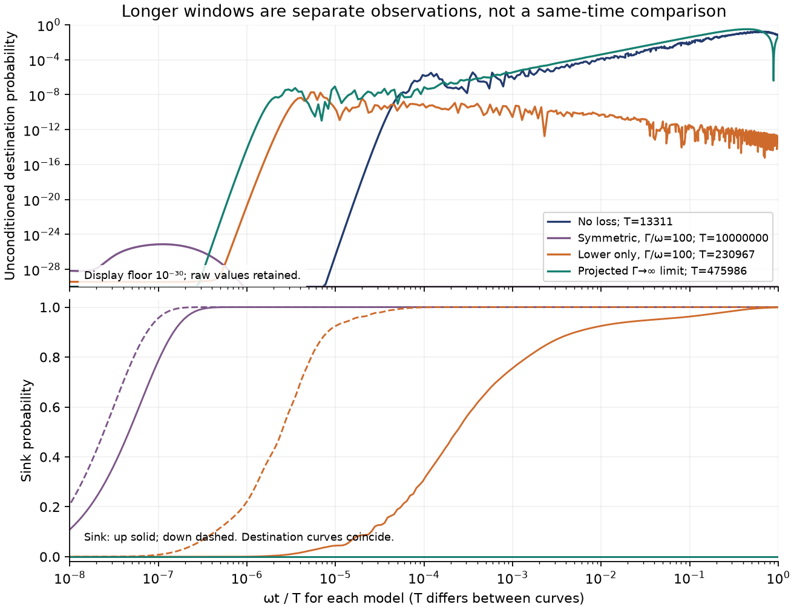

# Part 2b — many-quanta exchange and the cost of loss

At 15 quanta, loss changes the destination population and the surviving population in different ways. The comparison below uses N=2 and n₀=30000. That occupation is imposed on the model. It is not the archived foil occupation.

All four rows use the same window, ωt≤13310.99. This is 210.51 ps if the vibration quantum is 41.6203 meV.

| Model | Largest sampled destination probability | Sink probability, up | Sink probability, down |
|---|---:|---:|---:|
| No loss | .16687 | 0 | 0 |
| Symmetric intermediate loss, Γ/ω=100 | Below the 10⁻¹² fit floor | ≈1 | ≈1 |
| Lower-side intermediate loss, Γ/ω=100 | 1.8758×10⁻⁸ | .95438 | ≈1 |
| Projected Γ→∞ limit | .0028851 | 0 | 0 |

Forward and reverse destination probabilities coincide. Their sink probabilities need not coincide. The wavefunction is never renormalized after loss.

The projected limit reaches .31771 only in its longer window, ωt≤475985.75. That is 7.5276 ns under the same clock conversion. It is a singular limit, not the rate at Γ/ω=100.

## What was varied

The model uses one vibration and the exact symmetric J=N/2 spin sector. Each cell has coupling g/√N. Up starts with all nuclear systems low and n₀ phonons. Down starts with one bright nuclear excitation and n₀−q phonons. The target is a joint spin-and-photon state. One flip exchanges q dressed quanta. A larger collective endpoint can contain several flips.

The orders are 3, 5, 9, 15 and 21. N is 2, 4, 8. Occupation, coupling and loss are varied one at a time. The loss mask is fixed at each case's lossless resonance. The endpoints stay stable. No state lies on the decisive 15-quantum mask boundary; its nearest intermediate is .91846 quantum away.

The bare gap is retuned as loss grows. The accepted 15-quantum branch begins near bare 11.918. A preliminary 17-quantum branch was rejected. A nonzero bare 15-photon bin was not enough to identify the resonance. The full spectrum and continued cluster are retained in `branch_proof.json`.

At 21 quanta, the no-loss N=2 case reaches .01529 destination probability. The q≥15, N≥4 region has no supported order-resolved rate law here. Failed continuations and unsupported labels remain visible in the data.

## Scaling from the runs

The transfer metric is r=P_max/(2t₅₀). Here t₅₀ is the first time reaching half the largest sampled destination population. Time is measured in 1/ω. This is a prepared-state occupancy metric, not deposited power or a fusion rate.

These are separate local no-loss fits. Each exponent varies only its named coordinate.

| Exchange order | N exponent | Occupation exponent | Coupling exponent |
|---|---:|---:|---:|
| 3 | −1.117 | 1.064 | 2.588 |
| 5 | −2.042 | 2.211 | 4.244 |
| 9 | −3.949 | 3.567 | 7.334 |

N spans 2–8. Occupation spans 500q–4000q. Coupling spans .5–1.25 times its stated reference. The largest log residual in these rows is .230. Loss-case fits and their narrower ranges are in `fits.json`.

A separate 100-digit path calculation isolates the weak-coupling cancellation. Its no-loss amplitude coefficient scales as N to the power −(q−1)/2 on the computed grid. The lower-side projected coefficient approaches a constant at large N. This is an amplitude result. It does not include finite-loss survival.

The weak amplitude law is fitted at q=3–21 and N=16–1024. Its largest log residual is .00393 without loss and .206 in the projected limit. No finite-loss 15-quantum rate is extrapolated to the foil.

## Conditional extension beside the foil inputs

Let G=g/(ℏω). Use the real D–D gap 23.84653 MeV and the 41.6203-meV clock. The nearest allowed odd order is q=572954459.

| Population assigned for comparison | Formal weak-amplitude result | What the foil information supports |
|---|---|---|
| Archived 32768-site box: n≈472 | This Fock source has n<q. | A lattice count and modeled energy inventory, not measured coherent participation. |
| Illustrative N=10⁶: n≈14416 | This Fock source also has n<q. | No measured occupation for this region. |
| Conditional N=10¹¹: n≈1.442×10⁹ | No loss: log₁₀(V_abs/ℏω)≈−5.3053×10⁹+q log₁₀G. Projected limit: −2.3601×10⁹+q log₁₀G. | No destination-population support at these coordinates. G and coherent participation are unknown. |

The occupations use the archived .6-meV-per-D energy inventory. This is a formal extension far outside the fitted range. It is not a point prediction. It does not cover an unknown coherent-state tail or external work. The physical leading even-wave coupling remains zero; the physical odd and full second-order couplings remain unknown.

**Three omissions:** a physical nuclear coupling and loss spectrum; the foil's actual participating mode and preparation; support for the real-gap extrapolation.

Evidence: `results.json`, `transfer.csv`, `fits.json`, `branch_proof.json` and `consumer_proof.json`. QuTiP's explicit sinks and quimb's active-sector evolution agree within 5.02×10⁻¹¹ in the changed consumer. Survival conditioning would change the result by .358. Equations, source citations and reproduction are in [the method](method.md).
