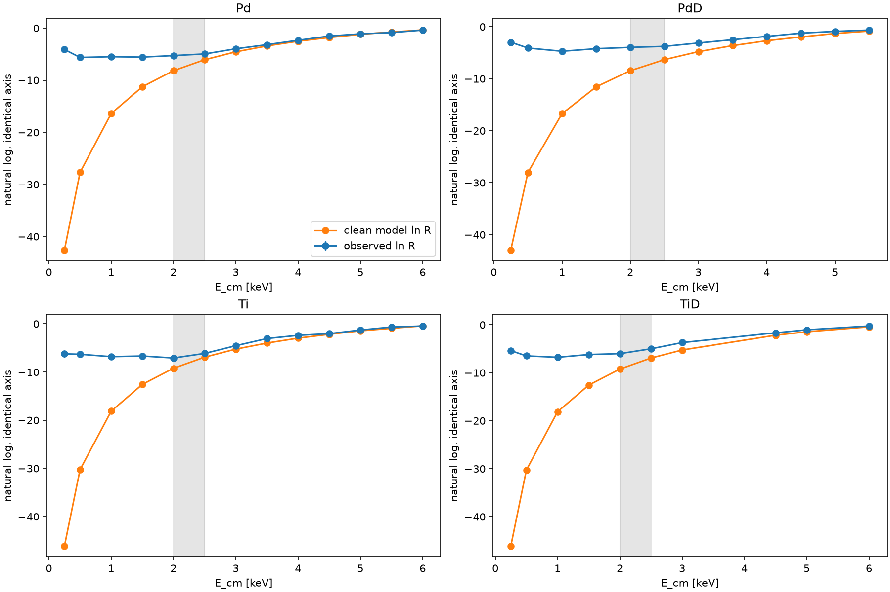
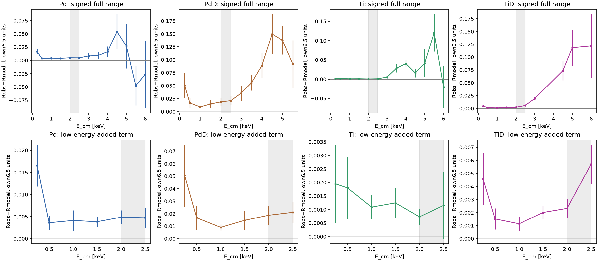
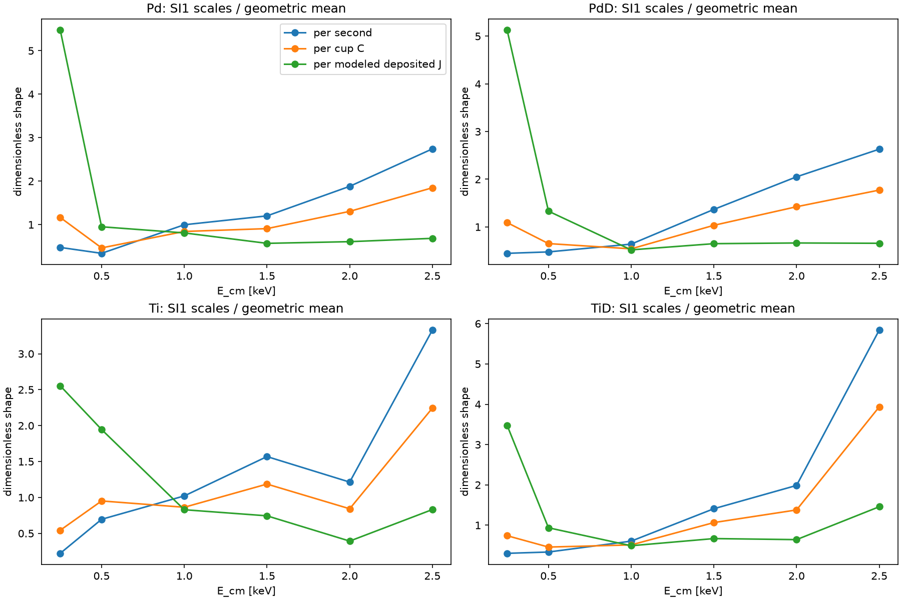
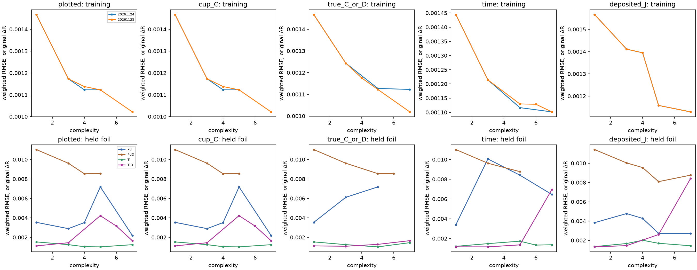
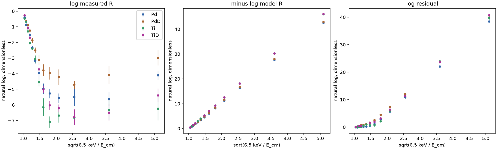
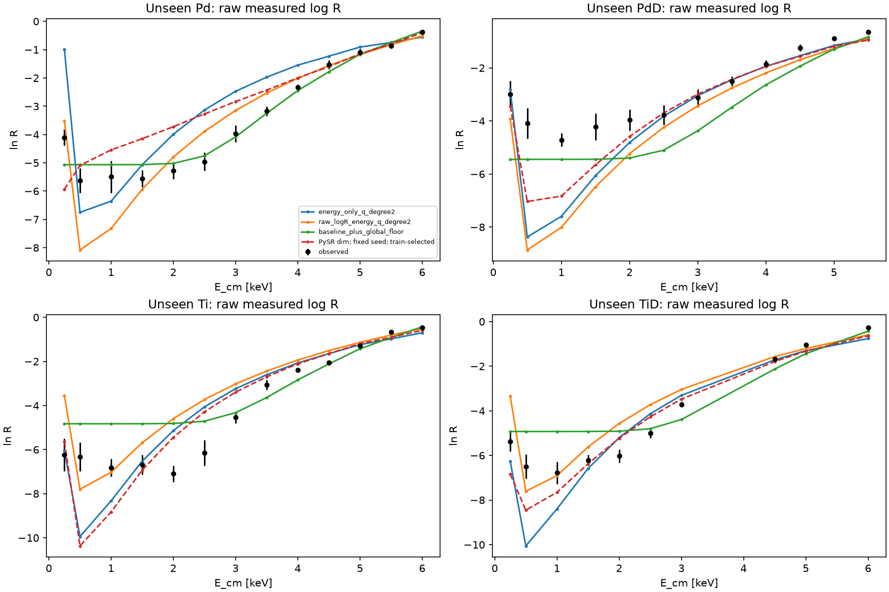

# G12: the added low-energy signal, before a mechanism

Physics kernel: `bf114e0874f2a01dc62505e7c7520cadf46fd20f`. Public catalog: `e89133b`, `g12_residual/data/observations.csv`, SHA-256 `1f5aab7e376bf45abe781966c2ca93bbbc9bd894fade27ae8a1044c146b7153d`. The accepted input ledger is reproduced first, unchanged.

# Inputs to the UC Davis residual denominator

`M` = current `main` at inspection, `bf114e0874f2a01dc62505e7c7520cadf46fd20f`. Paths below are relative to that revision unless stated. Axiom accepted the clean reference in Fleet `entry_3516`. “Not fitted” means not fitted to the 48 Davis yield ordinates; empirical inputs and approximations are still identified. Newer, narrower evidence does not replace an input outside its support.

| Input / adopted number or table | Source file | Revision / byte binding | Latest or superseded; what changes | Basis; fitted to these 48? |
|---|---|---|---|---|
| Pd bulk D(z), per nominal setting | `g4_beam/merit/profiles.json`, Pd `layers`; `merit/prepare.py` | `98efac29`; profile SHA `e2e91077595de602b815ae86f45c1a675d6a553153272d0e1295b72e2a5a9943` | Pass 5 transported depth profiles replace Pass 4 uniform targets. Later use is fixed-profile; no replacement found. | Conditional transport; not fitted to yield. |
| Pd adsorbed sheet, (1.52777–1.52966)×10¹⁹ D/m² | same file, Pd `nads_m2` | same | Native sheet consumed once; not a fitted surface layer. `g4_beam/transport/recomb/physical-result.json` is a later beam-**off** boundary estimate, not a replacement for beam-on `nads_m2`. | Conditional adsorption; not fitted to yield. |
| PdD bulk D(z), per nominal setting | same file, PdD `layers` | same | Same transport succession; G10 treats local motion, not foil depth/occupancy. | Conditional transport; not fitted to yield. |
| PdD adsorbed sheet, (1.52830–1.52973)×10¹⁹ D/m² | same file, PdD `nads_m2` | same | Native sheet; G9 calculates a response at encounter, not a new adsorbate column. The later beam-off recombination result does not replace it. | Conditional adsorption; not fitted to yield. |
| Ti bulk D(z), per nominal setting | same file, Ti `layers` | same | Transported profile replaces uniform target; no newer matched profile found. | Conditional transport; not fitted to yield. |
| Ti adsorbed sheet, (1.23340–1.38219)×10¹⁹ D/m² | same file, Ti `nads_m2` | same | Native sheet only; no replacement found. | Conditional adsorption; not fitted to yield. |
| TiD bulk D(z), per nominal setting | same file, TiD `layers` | same | Transport replaces uniform target; directed TiD₂ channel runs are not this foil. | Conditional transport; not fitted to yield. |
| TiD adsorbed sheet, (1.32151–1.38239)×10¹⁹ D/m² | same file, TiD `nads_m2` | same | Native sheet only; no replacement found. | Conditional adsorption; not fitted to yield. |
| Transport/sheet preparation and state | `g4_beam/merit/inputs_ledger.csv`, `merit/prepare.py`, `transport/transport.py` and `transport/bca_tables.npz` | M; merit ledger SHA `6d0a52176ef5f38eb185bd6996742c759fb8be9b3f351a07c6bc9bc0d5ab05d0` | 16 supplied, 40 generated exact-setting profiles; 12 h at ≤2 keV CM, 2 h above, 1 h preload for loaded; estimated adsorption .45 eV, trap .23 eV, capacity 6 D, clean sticking .5. No measured D-depth/time histories or replacement profiles. | Simulated and inherited parameters, not set by the 48 yields. |
| Electronic stopping | `g4_beam/forward/profile_thermal.py:21–26` → `g4_beam/transport/bca.py` | M; adapter SHA `e81574b3a56499a3d651a19aeb45722d022f1883ae727ffcc96881370019b07c` | Bragg sum of scaled Lindhard–Scharff, Pd×1.54, Ti×1.52 vs ICRU-49; distinct from direct `forward/consumer.py` ICRU default. G6 channel/G6 Pd inverse-dielectric/PdD head-on results do not replace this random foil stopping; no cross-foil curve. | Physical model calibrated to independent stopping, not Davis yields. |
| Nuclear stopping | same adapter and `transport/bca.py:sn_zbl` | M; same adapter SHA | ZBL Bragg sum on host and D at local SI densities; no matched later replacement. | Physical model; not fitted to yields. |
| Beam distribution and path | `g4_beam/forward/model.py`, `forward/consumer.py`, `g8_why/common.py` | M | 85/15 D⁺/D₂⁺ electrical current, 2 D per molecular charge, 5% Gaussian FWHM and 0.1 keV lab stopping cutoff. G8 scenarios do not change the published nominal mixture or supply measured high-energy neutrals. G9 drag is causal-minus-formed; do not add settled stopping twice. | Source beam context plus declared numerical approximations; not fitted to yields. |
| Nuclear S and branches | Bosch–Hale separate DD p+t and n+³He, `g4_beam/forward/model.py`; `g8_why/reaction.py` distinguishes smooth and resonance alternatives | M; model SHA `76604acd39c1e47995a1290281e737076e8c01235a706e93c20be37fb4d1e84b` | Smooth external evaluation for clean reference, with low-energy extrapolation labelled. No superseding matched p/n nuclear evaluation identified; G11 work is parked. | Independent nuclear evaluation, not the 48. |
| G8 threshold reaction | `g8_why/reaction.py`, `reaction_retained.csv`, `reaction_source_notes.md` | M; reaction code SHA `1270749a14dc43c57717754a77585877af11d9c53742af905d90c483ef1b759e` | **Remove Davis fit** (`resonance_common`, effective Γp ≈27.83 eV, and per-foil/positive basis fits). Separately: literal external Zr fit Γp=40 meV, 115°, 7 fm, p only; G8 reapplied it without Davis calibration. With “no fitted threshold-resonance term,” keep this external estimate as a separately named sensitivity, not primary. | External Γp/phase empirically fitted elsewhere; the ≈27.83-eV value and flexible bases were fitted to these 48 and excluded. |
| Static screening magnitude and radial form | `g6_collision/curves/baseline_BO_pair.json`; `g7_defect/README.md`; `g4_beam/forward/model.py:sigma` | M; radial SHA `854c570dc53ac5f0ff792f38393dea18c66dab7aa474d4f03b29d5e4e98a32a5` | Adopt declared common 40 eV in Eq. 7: exponent uses E+U and prefactor denominator is √[E(E+U)]; no explicit V(r) used. Motivated by 40.55 eV at 0.1 Å in PdD and 37–41 eV in Pd defect cells; not contact or material-resolved evidence. Later contact-plus-WKB `g7_micro/pd_oxide/action/results.json` gives a 39.0–48.64 eV equivalent shift for one ideal bare Pd slab site, not these four foil populations/adsorbates; `g7_micro/zr_calibration/action` and `g7_hydride` concern other targets. No universal radial replacement. `g6_delump` compares Eq. 7 vs ALR for D–T, not a D–D replacement decision. | Rounded physics-motivated approximation, not fitted to yields; site-specific radial sensitivities are distinct. |
| Proton/neutron join | Davis Methods DOI `10.1038/s41467-026-74421-1`; `g4_beam/merit/fits_transported.json` `screeningrise` k=1; `g8_why/common.py:60–75` | M; draft Davis asset 787712865 (SHA `03bbb17ad973323c32a512947883d4b97f1ded61f62854a4c416edbde8865c6b`) | **Remove s=1.0413535612834366**, fitted on these 48. Primary compares physical p through 4 / n from 4.5 keV on the paper's efficiency-corrected scale, without an imposed join amplitude. Frozen smooth-40 modeled n/p at 4.5 is a non-fitted sensitivity, not a measured calibration. The paper confirms proton-only below 3 keV but does not supply a pointwise overlap ledger; 4/4.5 is a model convention. | Source states correction/combination; raw p/n calibration is missing. Same-data s excluded; computed n/p is distinguishable from it. |
| 6.5-keV reference | Davis Fig. 2, `g4_beam/forward/errbars.csv`; `g8_why/common.py` | M | **Retain** one observed own-foil anchor R=1 and own model n yield at 6.5 with identical physics/readout to numerator. No same-data amplitude or cross-foil scaling. Four anchors are not fitted rows. | Paper normalization, not fitted. Reference covariance unavailable. |
| Fig. 2 digitization and current readout | `g4_beam/forward/errbars.csv`, Davis SI Table 1/Fig. S3, `g4_beam/forward/model.py:I_cup,collected_fraction`; `g8_why/method.md` | M; errbars SHA `6bb66867c8b899b66447831a193c173aa85575cf0f7f9e69d1bb8158b534f62c` | 48 points, observed values fixed. Primary k=0 per delivered C; k=1 changes model only by I_cup(6.5)/I_cup(E). Retain declared non-fitted focusing mapping `b_hi=1,b_lo=0` once, separately from current power; it is a chart interpretation, not measured per-run efficiency. No replacement pointwise charge/run ledger. | Digitized outcomes; chart I–V/nominal normalization choice not a run measurement or fitted shape parameter. |
| G8 ordinary target motion and beam scenarios | `g8_why/driven_target.py`, `driven_target_floats.csv`, `beam.md` | M; driven code SHA `6b2badb544bb999ab4f43f879d2836016eb21f3bb933d85ad4bd3f2473e6b447` | Use ordinary single Maxwell relative-flux correction at saved transport T, once. Not the hot 100-eV/100-ps case, fitted neutral share, spectator envelope or a second ZPM factor. G10 changes a narrower observable (next row). | Assumed model T and kinematics; not fitted to yields. |
| G10 quantum motion | `g10_quantum_site/output/exact/PdD_300K_joint_g8_joint.json`, `README.md`; `g8_why/collision/` | `2db003b`; G10 draft archive SHA `265239cc96b1289ac251b0c9f29ae483372d1e912c650a221c39f7298cd0d615` | Replaces harmonic bound-site distribution for the supported PdD single-site calculation; not a matched four-foil, energy/channel-resolved total thermal response. No added G10 yield term on top of Maxwell; G10 supplies a separately scoped comparison, not a correction to all four tracks. | Computed fit-to-electronic-well data, not fitted to the 48. |
| G9 entry transient | `g9_edge/output/yields.csv` (gated) and `sensitivity.csv` (`sheet_formed_bulk_wake`); `first_principles/edge.json`, `SUMMARY.md` | Model `ee7ffe9e`, native `e0a275b`; native file SHA `5c5e02cae7d1b4b7539e2f245629aafd788028d2f941a9a936aab05ceb316d09` | Native PdD(111) at 0.25 keV CM shows pre-surface response, replacing a bare-at-plane picture on that ray, but stops 0.5 Å before the target and provides no yield correction. Gated vs formed-sheet disagree (~0.28 vs 1.02 in Pd at .25); neither is a matched total-foil replacement. Use formed sheet as declared common proxy; show gated and no-edge as sensitivities. Pd RPA for all four, five computed settings; interpolate log raw ratios only within support and same foil/channel. Factorized with thermal correction; cross terms unresolved. No extra drag. | Time-response model + native partial constraint; not fitted. No exact native yield or identified surface prehistory. |

The saved exposure changes from 12 h at 2.0 keV to 2 h at the next sampled setting, 2.5 keV. Show the denominator and this boundary next to the observed and residual curves. Both energy and assumed exposure change across that interval: the difference is not a controlled exposure effect. Do not change or refit the profiles.

**Earlier results affected; no reruns.**

- `g4_beam/forward` Pass 4 uniform-target fits were superseded by Pass 5 `merit` transported-profile fits.
- `g4_beam/merit` screening-rise, fitted neutral and surface-layer comparisons and `g6_plateau` forecasts condition on same-data fit parameters; none enter this denominator.
- `g7_gap`'s 5.02 resonance comparison uses a fitted-high background; G8's literal external estimate is a distinct fixed-background sensitivity.
- `g7_micro` sigmoid carries a same-data-selected knee and fitted common splice; its two-state and exponential fits also fit the splice.
- `g8_why` normalized summaries and the G10 normalized collision demonstration carry the G8 stitch; their raw predictions and G10 joint spectrum are unaffected. G8's harmonic PdD example has a G10 single-site successor; its spectator envelope is a separate bound.
- `g9_edge`'s raw ratios did not use the stitch. Its gated-plane approximation predates the native pre-surface evidence.
- Parked G11 form fits used the inherited same-data stitch, and its fixed-knee sigmoid inherited the selected knee. Its fitted packet/survival forms remain notes, not inputs.

No provisional regression output is interpreted as evidence until the clean reference is computed.


## Main result: subtract before interpreting the ratio

Across 0.25–2.5 keV CM, the measured figure ordinate changes by **0.95–1.77 in natural log per foil**, while the clean model changes by **36.5–39.2**. The large, steep log ratio mostly exposes the model denominator collapsing beneath a comparatively slowly varying measured signal. It does not identify a pair-energy gain or a barrier mechanism. “Measured” here means the published, own-reference normalized Fig. 2 ordinate, not unpublished raw counts.



The informative first view is the signed addition `A_k = R_observed − R_model,k`. The secondary view is `h_k = ln(R_observed) − ln(R_model,k)`, exactly once. All 48 signed additions are retained, including negative high-energy values. Only the **24 rows at E≤2.5 keV** enter the short added-term searches; nothing was clipped or logarithmically transformed for those fits. The four 6.5-keV anchors are deterministic, not fit residuals.



The shaded 2.0→2.5-keV interval changes nominal energy **and** the fixed simulated exposure from 12 h to 2 h. The clean denominator rises there by 2.106/2.126/2.302/2.301 in ln R for Pd/PdD/Ti/TiD. This is not an isolated time effect or a discovered change point. No profile was varied.

## Levels, scatter and slopes

Numbers below are in `10^-3` of each foil’s own measured 6.5-keV reference; slopes are per keV. The weighted level and slope use the digitized **linear** observation half-widths, not the log-error floor. The ± values are formal diagonal-only one-sigma scales. They are **not calibrated confidence intervals**: shared reference and point correlations are unavailable. Every displayed slope’s formal ±2-sigma interval includes zero. Pd’s ±1-sigma slope interval includes zero under both readings; Ti’s 2.5-keV addition has a plotted linear interval reaching zero. Central-value log scatters below are descriptive, not a log-likelihood for that point.

| Reading | Foil | Weighted level ± formal scale | Weighted slope ± formal scale | Slope omitting 0.25 | Endpoint net slope |
|---|---|---:|---:|---:|---:|
| k0 | Pd | 4.385 ± 0.706 | -0.232 ± 1.126 | 0.644 | -5.263 |
| k0 | PdD | 11.312 ± 1.999 | 5.651 ± 4.507 | 7.029 | -13.079 |
| k0 | Ti | 0.975 ± 0.218 | -0.456 ± 0.412 | -0.409 | -0.353 |
| k0 | TiD | 1.948 ± 0.295 | 0.974 ± 0.553 | 1.309 | 0.501 |
| k1 | Pd | 4.180 ± 0.706 | -0.725 ± 1.126 | 0.123 | -6.010 |
| k1 | PdD | 11.230 ± 1.999 | 5.127 ± 4.507 | 6.492 | -13.652 |
| k1 | Ti | 0.912 ± 0.218 | -0.583 ± 0.412 | -0.550 | -0.671 |
| k1 | TiD | 1.907 ± 0.295 | 0.831 ± 0.553 | 1.155 | 0.188 |

Pd’s lowest point changes the slope’s sign when omitted. PdD has a positive weighted slope but a negative endpoint slope because its first point is high. Ti trends downward; TiD turns upward. “A constant floor” is therefore a useful comparator, not a precise common law. At higher energy A grows to about 0.12–0.15 in some foils and becomes negative in Pd/Ti; the low-energy constant approximation is not a full-curve description. Full point values, alternative model responses and uncertainty meanings remain in `additive_rows.csv`, `additive_summary.csv` and their `k1/` counterparts.

## What is it approximately constant in? Two measurement scales

### Fig. 2: own-reference proxies, both current readings

The same observed R is used in both readings. `R_model,1 = R_model,0 I_g(6.5)/I_g(E)`, using the retained G4 chart convention. Consequently `h_1−h_0=ln[I_g(E)/I_g(6.5)]`; transforming both axes instead would merely create an invariance check. The paper’s statement “All yields were reported per delivered Coulomb” supports k0 on its face. The dose inferred from the Faraday-cup I–V curve rather than a per-run charge ledger, and Fig. 2/SI1 processing differences, motivate k1 **as a sensitivity**, not evidence for a duplicated division.

For relative shape comparisons define `q_k=A_k[I_g(E)/I_g(6.5)]^k`, `d_k=q_k c(E)/c(6.5)`, `t_k=q_k I_SI(E)/I_SI(6.5)` and `j_k=d_k ε_dep(6.5)/ε_dep(E)`. These are dimensionless own-reference per-cup-C, inferred true-C/per-D, per-time and deposited-J **proxies**, not absolute emission rates. G4’s readout current and the independently transcribed SI chart are kept distinct. Under the fixed 85/15 electrical mixture, per incident D differs from true-C only by the constant `e/1.15`; their scatter cannot be ranked separately.

Population SD of central `ln A` in the transformed low-energy units:

| Foil | k0 cup C / D | k0 time | k0 deposited J | k1 cup C / D | k1 time | k1 deposited J |
|---|---:|---:|---:|---:|---:|---:|
| Pd | 0.522 | 0.345 | 1.291 | 0.315 | 0.559 | 0.919 |
| PdD | 0.518 | 0.390 | 1.243 | 0.376 | 0.668 | 0.796 |
| Ti | 0.327 | 0.262 | 1.171 | 0.318 | 0.595 | 0.952 |
| TiD | 0.573 | 0.672 | 1.046 | 0.629 | 0.964 | 0.638 |

For Fig. 2 k0, time is the flattest of these proxies in Pd/PdD/Ti; k1 instead makes per-C/D flatter than per-time in all four. No normalizer makes every foil flat. At a fixed energy the applied factors are common across the four foils, so they do **not** make the foils more alike: loaded/unloaded ratios and cross-foil log scatter are unchanged. Different unknown own-reference amplitudes still prevent an absolute cross-foil floor comparison.

### SI Table 1: the published detected-signal proxy

SI1 is kept separate from Fig. 2. With the reported signal/background ratio B and background 0.007 counts/hour, `r_det=B×0.007/3600` detected counts/s and `q_det=r_det/I_SI(A)` detected counts/cup C. Inferred true-C is `c q_det`; detected counts per incident D is `e c q_det/1.15`; counts per modeled deposited J is `c q_det/ε_dep`. There is no measured detector acceptance, no SI1 6.5-keV anchor and no run-level join to Fig. 2: **do not subtract modeled emitted reactions from these detected counts or calibrate them by the model’s neutron reference**. They approximate an added detected component only where the baseline is negligible, not an exactly identified absolute A_det. k0/k1 do not create two SI1 observations.

The 12–24 h statement supplies only conditional count brackets at the applicable ≤2-keV points. It is neither an exact exposure nor a new denominator; the per-second proxy above does not require an invented duration. Missing brackets at other energies remain blank.

| Foil | Detected counts/cup C, min–max | Detected counts/hour proxy, min–max | SD ln(per time) | SD ln(per C or D) | SD ln(per deposited J) |
|---|---:|---:|---:|---:|---:|
| Pd | 0.429–1.705 | 0.105–0.847 | 0.726 | 0.427 | 0.779 |
| PdD | 0.760–2.494 | 0.210–1.239 | 0.702 | 0.413 | 0.787 |
| Ti | 0.768–3.170 | 0.105–1.575 | 0.825 | 0.430 | 0.626 |
| TiD | 1.773–15.246 | 0.392–7.574 | 1.048 | 0.723 | 0.654 |



SI1 favors charge/D over time on Pd/PdD/Ti; modeled deposited J is flatter only in TiD. This differs from the Fig. 2 k0 proxy ranking. SI1’s endpoint signals rise in counts/time and counts/C, but the first Pd point is above its 0.5-keV point. Without SI1 errors and a common processing ledger these are descriptions, not a formal preference for a universal normalization.

`deposition.csv` reuses the matched saved G8 deposition and extends only the two missing low-energy settings using the same frozen-profile CSDA accumulator. It finds complete slowing to the 0.1-keV-per-D cutoff, giving `ε_dep≈2000 E_cm−115 J/C` (385, 885, 1885, 2885, 3885, 4885 over the low-energy settings). The maximum saved/extended energy-balance difference is 2.31e−6 J/C. This is deposited stopping energy in the retained model, **not all incident energy, not measured beam power, and not energy assigned to a selected mode**. Row provenance and terminal energies are preserved; source-based current, assumed area and model deposition are not independent levers.

## Short symbolic forms and genuine held-foil predictions

Actual weighted PySR 2.7.2 fits the **direct transformed addition**, scaled by the fixed 0.01 reference fraction for numerical convenience. Inputs are `e=E/6.5`, the published chart `Isetting=I/Iref`, `z=Z/46`, nominal preparation 0/1, and independently computed `dep_model=ε_dep/ε_dep,ref`. None is y, A, fitted U, the exact yield denominator, S:B or a response-derived density proxy. Current and deposited energy are functions of nominal setting in this data set, not independent measurements. Prepared means beam-plus-electrochemical preparation, not an assayed D concentration.

Operators are `+ − × ÷ sqrt log`, binary64, maximum expression size 7. Selection is fixed **minimum training loss at complexity≤5**. The complete training fronts are retained; a second full-data seed audits expression recurrence, while each foil is held out entirely before training. No expression, normalization or complexity is chosen using its held-foil score. The held energies are covered by training, but **none of the held host×preparation combinations occurs in training**; these are new-condition predictions, not proof of joint material support. Unknown run IDs remain unknown.

For every candidate, its transform is inverted before computing the original ΔR loss; comparing errors in different units cannot manufacture a winner. Selected full-data examples below predict `A_transformed/0.01`; these are host contrasts on just two host levels, not atomic-number scaling laws.

| Normalization | k0, fixed first seed | k1, same seed |
|---|---|---|
| plotted | `(z * 0.7350059164464033) + -0.2196955141420807` | `(-0.3389970726147876 / z) + 0.8351489729887357` |
| cup_C | `(z * 0.7350059164464033) + -0.2196955141420807` | `z * (z * 0.22196621308160613)` |
| true_C_or_D | `(z * z) * 0.31854947606715966` | `(z * 0.16828267325613716) + -0.047235002505605354` |
| time | `(z * 0.2919285841183876) - 0.08145295454128153` | `e * (z - 0.3468856700802423)` |
| deposited_J | `z * (z + prepared)` | `(z - Isetting) - -0.2058638606527345` |

Host z occurs in all 30 audited training-selected short expressions in each reading; preparation occurs in 6 versus 2, current in 2 versus 9, and model deposition in 2 versus 1. These are correlated rescalings/searches of the same small table, not independent replications. The increased current recurrence under k1 is convention-sensitive, not evidence for an independent current effect. Exact expressions do not recur as one stable physical law across conditions.

Held-foil weighted RMSE in the **same original ΔR**, multiplied by 1000:

| Reading | Candidate normalization | Pd | PdD | Ti | TiD |
|---|---|---:|---:|---:|---:|
| k0 | plotted | 7.181 | 8.546 | 1.020 | 4.227 |
| k0 | cup_C | 7.181 | 8.546 | 1.020 | 4.227 |
| k0 | true_C_or_D | 7.181 | 8.546 | 1.020 | 1.277 |
| k0 | time | 8.415 | 8.772 | 1.730 | 1.357 |
| k0 | deposited_J | 2.724 | 8.089 | 1.692 | 2.601 |
| k1 | plotted | 10.134 | 9.557 | 1.048 | 4.174 |
| k1 | cup_C | 8.465 | 8.156 | 1.258 | 1.280 |
| k1 | true_C_or_D | 8.465 | 8.724 | 1.281 | 1.241 |
| k1 | time | 10.081 | 9.557 | 1.392 | 1.353 |
| k1 | deposited_J | 2.542 | 9.510 | 0.996 | 5.720 |

The constant-per-cup-C null gives Pd/PdD/Ti/TiD errors 3.541/11.018/1.531/1.120 (k0) and 3.615/11.094/1.750/1.171 (k1), in the same displayed units. A training-only signed linear ΔR(E) gives 3.523/10.976/1.852/1.268 and 3.383/10.860/1.773/1.224. The short symbolic formulas do not establish a generally transferable improvement over those simple references. A low held error in one rescaling/foil is not used to select a physical constant. Full complexity/loss, nonfinite predictions, held rows and reconstructions are in `additive_fronts.json`, `additive_fold_scores.csv`, `additive_held_predictions.csv`, `additive_simple_baselines.json` and `k1/`.



## Loaded versus beam-only, at each low energy

These are ratios of A from **separately own-normalized curves**, not absolute loaded/unloaded emission enhancements. The full CSV gives first-order uncorrelated plot-bar propagation; reference covariance is unknown and several bars are large. Each common normalization factor cancels at fixed E to numerical precision.

| E_cm keV | PdD/Pd k0 | PdD/Pd k1 | TiD/Ti k0 | TiD/Ti k1 |
|---:|---:|---:|---:|---:|
| 0.25 | 3.051 | 3.051 | 2.349 | 2.349 |
| 0.5 | 4.633 | 4.633 | 0.839 | 0.839 |
| 1 | 2.180 | 2.180 | 1.043 | 1.043 |
| 1.5 | 3.828 | 3.838 | 1.610 | 1.611 |
| 2 | 3.860 | 4.007 | 3.175 | 3.431 |
| 2.5 | 4.469 | 6.520 | 4.944 | 11.356 |

The raw scatter is in `additive_loaded_ratios.csv` and `same_energy_contrasts.csv`. A preparation/host/sheet contrast remains; these data do not isolate measured D loading, accumulated dose, surface chemistry or an independent beam-current dependence.

## Second view: why the log ratio is steep

The exact identity is `h=ln R_obs−ln R_model`. For the elementary Eq.7 cross section, `−ln σ = B_G/sqrt(E+U) + 0.5 ln[E(E+U)] − ln S(E)`. The actual denominator is a fixed-profile thick-target integral with current/readout factors, not exactly this elementary expression, but it inherits the rapid barrier collapse. Reciprocal-energy, square-root and log-based fits to h can approximate that known denominator; observing them is not discovering new barrier physics.



The full multiplicative fronts remain in `pysr_fronts.json`, `complexity_scores.csv`, `expression_recurrence.csv` and `k1/`, with raw-unit and dimensionless inputs. Selection there is also training-only (complexity≤9; full search size≤12). Reconstructing held **ln R_obs**, not merely scoring h, shows the remaining low-energy errors and scatter:



A normalized global additive-yield comparator `R_hat=(R_model+c)/(1+c)`, with c fitted only to training foils, has held log-wRMSE 0.209/0.626/0.472/0.533 under k0 and 0.272/0.504/0.389/0.383 under k1. It is competitive with the short h formulas, but its single normalized floor is not a shared absolute rate or a demonstrated extra channel. The energy-only q and raw-ln-R q comparators, reference-only result and all held maximum errors are preserved in `simple_baselines.json` and `baseline_held_predictions.csv`. h formulas can still miss a held point by several natural-log units.

Current-setting, run-time model and range aliases are catalogued before fitting in `feature_inventory.csv` and `energy_alias_audit.csv`; `raw_covariates.png` retains all relevant numeric source/context/model features with unknown entries visibly absent. Source typical flux/spot, anneal temperature, simulated range endpoints and saved target temperatures are not reclassified as per-run measurements. The same-energy cross-foil log contrasts cancel the common k0/k1 current shift, but not the distinct reference amplitudes or host/preparation confounding.

## Final public catalog: comparable responses, not a pooled likelihood

The final joined input has **2,425 source rows and 16 study keys**, including fits, normalization anchors, repeated report-level values, characterization and other reactions. These are not 2,425 independent fusion measurements. Only the joined CSV is consumed; neither the earlier 303-row intake nor duplicated `inputs/` blocks is stacked into it. `external_support_grid.csv` retains every row class, native units, reaction/channel, lab, uncertainty coverage, energy range, target/support counts and missingness. `external_residuals.csv` preserves each source row and reports **1,638 separately qualified native residual rows** (including references), not a common Davis target. Czerski’s 83 detected-yield rows also have explicitly secondary self-rebased shape diagnostics. Missing/non-comparable targets remain blank, never zero.

| Source response | Treatment and result |
|---|---|
| 1,337 D-D p+t S(E) rows, Raiola/Bochum family | `ln[S_obs/(S_bare f40)]` and `S_obs−S_bare f40` are **native S** residuals, not added yield per charge. Use source `43+0.54E` keV·b, Ta’s distinct `53+0.48E`, and a separate BH40 sensitivity. Exact inaccessible-article normalization is flagged conditional for the relevant editions. Temperature/preparation series support target-state dependence, not a Davis current law. Both lab labels “Bochum” and “Ruhr-Universität Bochum (DTL; LUNA collaborators)” denote this facility family; splitting them would manufacture a laboratory holdout. |
| Berlin 170 reduced-enhancement points plus 13 deterministic references | The published F is reduced y(E)/y(12.5 CM), not plain yield. The conditional BH gas integral weighted1/sqrt(E) is matched before mapping to a 40-eV comparator or reconstructing relative yield. Its exact source gas evaluation is not silently claimed reproduced. Native lowest sampled energies are generally above the Davis floor range; reconstructed observed/model shapes continue to fall together rather than providing a universal flat addition. Ta A–E retain distinct surface preparations. |
| Yuki 1997 Ti/Yb, own3.225-CM p reference | Ti’s conditional homogeneous D/Ti=2 kernel uses a **changed ICRU+ZBL approximation**, not the exact source Anderson–Ziegler curve. Across1.283–2.428 CM, observed/model log spans are7.40/7.37 and the addition changes sign: a useful counterexample to a universal positive Davis-like floor. Yb remains source-only; its stopping is not invented. |
| 1998/2002 Tohoku/Kasagi relative p yields, own5-CM references | A declared homogeneous velocity-proportional-stopping BH40 comparator follows the source-style bare calculation; actual layered profiles remain unresolved. Ti/Au observed log spans5.84/5.55 versus model5.59 over1.5–2.5 CM are barrier-shaped, with mixed-sign additions. Pd and oxide-facing foils show enhanced yields but their additions vary strongly with energy: the layered1998 series spans about3e−5 to8.4e−3 of its own reference, not a flat universal rate. Preliminary1998 and repeated2002 source lineages are not counted as independent replications. |
| Czerski2024 detected counts/(µA ks), 83 rows | Preserve detector-normalized yield and separate host/panel/beam state. A highest-energy measured anchor creates a **secondary** self-rebased cold-BH40 sqrt-stopping shape comparison, with unknown common covariance and unmodeled source neutral components, never a fitted M/Ue or absolute acceptance. Low Zr D2 and Ti D3 log spans2.82/3.88 versus cold-model14.40/13.15 show much softer falls, but the additions vary and beam states differ. |
| Chen2025 time series, backgrounds, saturations and3 contrasts | Rate contrasts at15 CM are positive (reported increases15.1%,11.3%,18.5%; log ratios0.141,0.107,0.170). They demonstrate a loading-state intervention in that source, not an absolute low-energy floor or fixed-inventory transient. The144 beam-on bins,6 backgrounds and the summaries are statistically dependent; no random-row holdout or conversion to Davis yield is made. |
| Cvetinović hard/soft Pd; Li/proton/³He channels; loading/NMR characterization | Retained as explicitly separate controls/comparisons. Cvetinović’s fluorine/lithium reactions are **not D-D**, and “soft” is not a documented manufacturing anneal of the same foil. No D-D target, point energy or electron density is manufactured from these records or from fitted U values. |

`external_added_terms.csv` and `external_added_summary.csv` perform the same additive-versus-multiplicative question in the stated native/reconstructed response. S additions are S-factor differences, not a new yield channel; reduced-yield reconstructions explicitly depend on their gas-kernel approximation. Source-fitted U at unknown E does not define a unique row residual and is never expanded into a pseudo-energy series. Alternative fitted values/limits, source edition differences and repeated summaries remain visible in the support accounting. The original source notes are under the separately delivered data partition.

### What laboratory holdout was actually evaluable

No second lab supplies the Davis fixed profile/readout target. A **secondary Ti proton shape-transfer stress test** trains without the held laboratory and compares adjacent-energy log-residual differences only within energy overlap; it cancels a reference level without fitting a held-lab intercept. It does not turn a homogeneous source target into a transported Davis target.

| Training → held source | Supported held rows / adjacent differences | k0 shape RMSE | k1 shape RMSE |
|---|---:|---:|---:|
| Davis Ti → Yuki Ti | 19 / 18 | 0.421 | 0.420 |
| Yuki Ti → Davis Ti | 4 / 3 | 2.356 | 2.303 |

These unequal-spacing adjacent differences are dependent, descriptive scores, not significance or fixed-profile validation. Most Yuki point errors are unpublished, so its training uses **unit optimization weights**, not fabricated uncertainties; the published errors remain intact. Exact training/held IDs, excluded support, full fronts and simple baselines are in `laboratory_shape_stress.json` and `k1/`. The final catalog does not justify a pooled additive-level LOLO score with incompatible own references and unmeasured per-source amplitudes.

## What the forms do and do not narrow

The recurring energy forms in h principally identify an almost-absent nominal-energy denominator; the direct-A forms principally identify foil-level contrasts. Neither establishes a collision energy gain, a surface depth law, a dose build-up law or a temperature/mobility law. The independent rows show real preparation/loading/temperature associations, with source-specific signs, units and confounding; they do not supply the missing independent Davis covariate variation.

Previously searched **named regimes**, not universal mechanisms, are already too small or wrongly shaped under their stated conditions:

- The G8 source-literal external40-meV threshold term changes the present normalized log residual by at most1.86, versus up to40.7 still required; the fitted Davis threshold strengths are excluded, not reused. This is not a bound on all nuclear response.
- G8 ordinary Maxwell motion and G10’s supported bound PdD single-site distribution do not create a keV encounter tail in those calculations. G10 is not stacked as an extra all-foil correction. Excited collective states in general were not established or excluded by these fits.
- G9’s modeled formed/gated/no-edge alternatives are order-unity readout sensitivities, not the many-order low-energy signal. The native clean PdD ray does not give an exact four-foil yield correction.
- G8’s ordinary beam composition/paired-arrival scenarios do not provide the missing size; an above-nominal neutral tail remains conditional on an unmeasured beam component, not proved or universally excluded. Parked G11 fitted packets/sigmoids are not evidence or denominator inputs here.

**One discriminator:** on the same prepared foil at one fixed energy, interleave controlled current levels with matched fluence (and a same-current changed-fluence arm), measure collected charge and live time independently, monitor the impinging energy/neutral distribution, and keep or record foil temperature/state. A per-charge addition predicts rate proportional to current at fixed state; a time-background addition does not; history dependence appears in matched-fluence versus matched-current arms. At fixed energy, per-C/per-D/per-deposited-J are collinear, so this experiment does **not** distinguish charge scaling from deposited-energy scaling. It separates the rate/current/history ambiguity that the present table cannot. This is a proposed measurement, not a scheduled campaign or a constructed mechanism.

## Three largest omissions

1. Actual run-resolved charge, fluence, live time, beam energy/species and target loading/temperature/depth histories; chart proxies and assumed12h/2h histories cannot replace them.
2. The experimental6.5-keV absolute scale, detector/overlap processing and shared covariance linking Fig.2, SI1, proton and neutron observations.
3. Matched cross-lab profiles and source-kernel/geometry information, plus the uncertainties of the factorized thermal/edge/static40-eV model. Native S/reduced-yield/rate comparisons remain conditional rather than a common absolute response.

## Reproduce and package

Scientific runtime used: Python3.12, NumPy2.5.4, SciPy1.18.1, Matplotlib3.11.2, actual PySR2.7.2 and private Julia backend manifest1.11.9. No build, lint, formatter, broad test suite, density refit, new DFT or old-node replay was run. The producer’s forward controls are retained in `davis_baseline.json`; the integrated consumer directly joined the final catalog, preserved the48 keys/source channels, exercised the settled k0/k1 plots and held reconstructions, and exited normally. These are finite computations and conditional model comparisons, not a mechanism proof.

From the pinned physics checkout with the data overlay at e89133b:

```sh
export JULIA_NUM_THREADS=1 OMP_NUM_THREADS=1 OPENBLAS_NUM_THREADS=1 MKL_NUM_THREADS=1
python g12_residual/regression/analyze.py --external g12_residual/data/observations.csv
python g12_residual/regression/analyze.py --reading k1 --catalog g12_residual/data/observations.csv
```

These commands reuse frozen symbolic fronts. Add `--search --additive-search --transfer` only to repeat the searches; fixed seeds20261124/20261125 and the complete configuration are in `analyze.py`. Bounded searches can return different formulas on a different backend; the delivered expressions, predictions and losses are frozen evidence. `--prepare-deposition` rebuilds only the matched deposition readout from the retained inputs, not the profiles.

A portable Davis replay can use the explicitly curated snapshot instead of the separate source partition:

```sh
python g12_residual/regression/analyze.py --joined-input g12_residual/regression/analysis_rows.csv
python g12_residual/regression/analyze.py --reading k1 --joined-input g12_residual/regression/analysis_rows.csv
python g12_residual/regression/analyze.py --package
```

The whitelist manifest binds scripts, clean producer CSV/JSON, this page, the exact `inputs_ledger.md`, figures, fronts, predictions, deposition and final source-support/native-result tables. It excludes PDFs, underlying raw datasets, source-owner duplicate inputs, logs, Julia/PySR working snapshots and `provisional_preledger/`. That quarantined pre-ledger evidence is not interpreted or shipped. The archive contains only regular paths beneath `g12_residual/regression/`; its members are read back against the exact frozen payload bytes. No release, publication, push or commit is performed by this consumer. Governing shared plan: `coherencev1-g12-residual-20261124`; delivery closure and final archive identity are reported separately.
