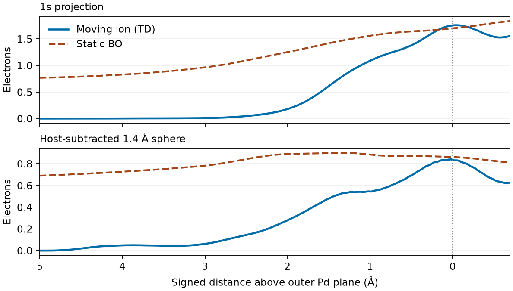

# The deuteron arrival edge in PdD(111)

A 0.5 keV bare D⁺ enters a frozen, clean PdD(111) slab along a prescribed normal ray toward the first subsurface D. Real-time PBE/PAW (GPAW) follows the electrons; an unconstrained Born–Oppenheimer (BO) calculation at the same geometries is the static comparator. Time starts 5 Å above the outer Pd plane; signed distance is positive outside and axial force is positive outward.

## Target: absolute TD − BO

| Observable at the buried D | Peak in the sampled ray | Time (fs) | Half-height width (fs) |
|---|---:|---:|---:|
| Induced electrostatic potential energy for a positive unit charge | +5.20 eV | 2.212 | 0.446 |
| Outward axial-force correction | +2.70 eV/Å | 2.280 | 0.213 |
| Inward axial-force correction | −4.74 eV/Å | 2.592 | Cut off |

The steepest adjacent-sample rates in the edge window are +19.2 eV/fs for the potential and −65.9 eV/(Å·fs) for the axial force. Integrating the background-subtracted forces from 0.8 Å above the plane to the cutoff gives a target axial impulse correction of −0.166 eV·fs/Å. Converting the TD and BO impulse vectors separately to recoil gives a peak TD estimate of 0.0141 eV and a maximum signed excess over BO of +0.00188 eV. This is a frozen-position estimate, not a deposited-energy measurement. The +5.20 eV is a local potential-energy difference, not recoil or a fusion screening-energy fit.

## Projectile charge pickup

The 1s projection first reaches half BO at 1.40 Å above the plane (1.645 fs), with a fastest rise of 2.53 projected electrons/fs. The host-subtracted 1.4 Å sphere reaches half BO at 1.58 Å (1.563 fs), with a largest sampled rise of 1.46 electrons/fs. At the cutoff, 0.5 Å before the buried D center, the two measures are still short of BO by 0.281 and 0.186 electron, respectively. Neither is a formal charge state; the moving hard-mask sphere is a grid-sampled diagnostic.

**The 4-as time step was not checked against a finer run, and the last force lobe is cut off by the end of the ray.** The single ray omits nuclear backreaction, the adsorbed-D layer, and the range of foil environments and incident paths. It resolves a transient omitted by a static model; it does not quantify the UC Davis yield discrepancy.

[Potential and vector force](edge.csv) · [Charge pickup](edge.charge.csv) · [Impulse and recoil](edge.receivers.csv) · [Summary](edge.json) · [Source bindings](provenance.json). The force/potential CSV gives raw TD and BO and, last, the same difference with its initial value removed. The static profile interpolates 13 BO anchors; the four held-out differences at each site are in `edge.json`. The native journals and NumPy/SciPy readout are included.
